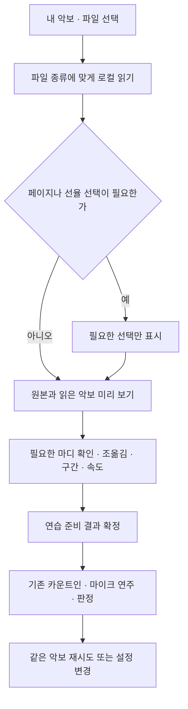
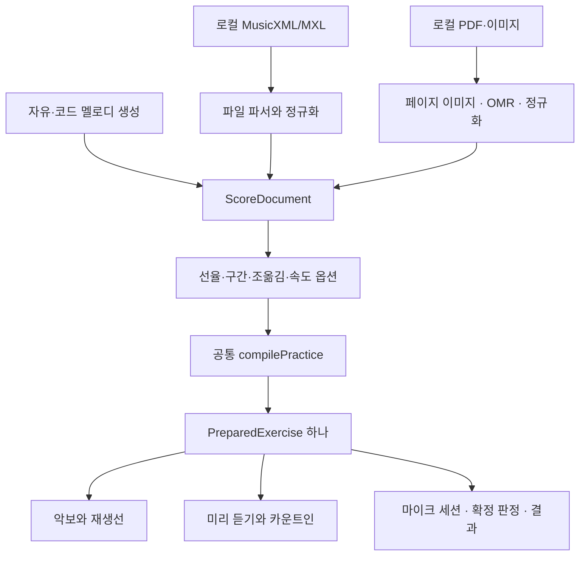

# 내 악보 불러오기와 멜로디 연습

상태: 미구현 설계. 우선순위 2. 기준 코드: `4f98b35`.

사용자가 고른 악보를 서버에 저장하지 않고 읽어, 현재 멜로디 연습과 같은 악보·재생선·마이크 판정으로 연습한다. 조옮김, 음역 조정, 구간·속도 선택을 제공한다. 선행 코드 진행 옵션은 구현·검증을 마쳤다. 현재 멜로디 연주기를 기반으로 이 기능의 공통 악보 표현과 파일 입력을 연결한다.

## 제품 범위와 기본 결정

- 요구된 `서버 저장 없음`을 구현 기본값에서는 **파일 본문을 서버로 전송하지 않는 기기 내 처리**로 정한다. 로컬 파일 선택 UI를 사용하며 파일 저장 API를 만들지 않는다.
- MusicXML/MXL 같은 구조화 파일과 사진·스캔 PDF 모두 목표 범위에 포함한다. MusicXML을 읽는 기능만 완성하고 사진/PDF 인식까지 끝났다고 하지 않는다.
- 연습 대상은 선택한 한 선율이다. 여러 성부·피아노 양손·화음 전체를 마이크로 동시에 판정하는 기능으로 확대하지 않는다.
- 원본 악보의 음정·음가·쉼표·붙임줄과 문맥을 보존한다. 지원하지 못하는 내용을 첫 마디의 박자·조표로 뭉개거나 임의 음표로 메우지 않는다.
- 새 상위 게임이나 별도 채점기를 만들지 않는다. 파일/인식 경로가 끝난 뒤에는 생성 멜로디와 같은 연주기로 들어간다.
- 새 의존성이나 OMR 엔진은 아직 선정·설치한 상태가 아니다. 아래 기술 검증을 통과한 뒤 구현에서 결정한다.

## 파일별 처리와 구현 순서

| 입력                | 읽는 방법                              | 의미                                                         |
| ------------------- | -------------------------------------- | ------------------------------------------------------------ |
| `.musicxml`, `.xml` | 악보 구조 파서                         | 음표·마디·성부가 이미 들어 있는 데이터를 읽음                |
| `.mxl`              | 컨테이너 해제 후 MusicXML 파싱         | 압축된 구조 악보. 이미지가 아님                              |
| PDF                 | 선택 페이지를 이미지로 렌더링한 뒤 OMR | PDF를 열거나 글자를 추출하는 것만으로 음표가 인식되지는 않음 |
| PNG/JPEG 등 이미지  | 방향·기울기·영역 정리 후 OMR           | 인쇄 오선 악보를 구조 데이터로 복원                          |

OMR은 Optical Music Recognition이다. 일반 문자 OCR이나 범용 이미지 설명 결과를 그대로 정답 악보로 쓰지 않는다.

### 2A — 구조화 파일과 공통 연습 기반

MusicXML/MXL → 정규 악보 → 선율·구간·조옮김 → 같은 연주기를 먼저 완성한다. 정확한 입력을 사용해 표기와 판정의 일치를 검증할 수 있는 단계다. 붙임줄과 악곡 중 조·박자·템포 변화도 이 기반에서 다룬다.

설치된 alphaTab 1.9.0의 공개 `ScoreLoader.loadScoreFromBytes`는 로컬 MusicXML 바이트 파싱에 재사용할 수 있는 후보다. 저장소 조사에서는 최소 C4 한 마디 파싱까지 확인했다. MXL의 컨테이너 처리 코드는 있으나 다양한 파일과 MusicXML 요소의 실제 호환성은 구현 시 fixture로 검증해야 한다. 라이브러리의 파일 지원과 앱의 올바른 연습 지원은 구분한다.

### 2B — 사진/PDF 인식 기술 검증

2A와 독립적으로 작은 실험을 먼저 진행할 수 있다. 인쇄된 단선율, 여러 조표·임시표·음가·쉼표·붙임줄, 페이지 경계, 회전·촬영 품질을 포함한 자료로 브라우저 실행·정확도·시간·메모리를 확인한다.

첫 목표는 선명한 인쇄 오선 악보다. 손글씨, 심한 원근 왜곡, 임의의 복잡한 피아노 전곡까지 같은 정확도를 약속하지 않는다. 후보가 기기 내 처리와 성능 기준을 충족하지 못하면 사진/PDF를 일반 기능으로 출시하지 않고 엔진 선택을 다시 검토한다. 외부 모델 API로 파일을 보내는 자동 fallback은 두지 않는다.

### 2C — 인식 결과 확인과 연습 연결

검증한 OMR 출력도 2A와 같은 정규 악보로 변환한다. 필요한 마디 확인·수정을 거쳐 같은 준비/연주 흐름에 연결한다. PDF 전용 재생기, 이미지 전용 정답 계산기, 별도의 결과 화면을 만들지 않는다.

기능 2의 완료는 2A뿐 아니라 2B·2C의 대상 인쇄 악보까지 검증한 시점이다. 단계별로 배포하더라도 지원 파일 유형을 실제 상태에 맞게 표시한다.

## 화면 흐름



- 멜로디 연습 안에서 `내 악보`로 진입한다. 예시 경로는 `/melody/import`와 각 언어 경로다. 상위 내비게이션 항목을 또 늘리지 않는다.
- 파일 하나를 고르면 미리 보기를 먼저 제공한다. 선택 성부가 하나라면 성부 선택 단계를 생략한다.
- PDF는 페이지 썸네일과 연습할 페이지/영역 선택을 제공한다. 전 페이지 고해상도 인식을 강제로 먼저 실행하지 않는다.
- 구조화 파일에는 인식 모델 다운로드·사진 보정 같은 단계를 보이지 않는다.
- 원본 비교는 펼쳐서 확인할 수 있게 한다. 사진 인식 결과에서 필요한 부분만 원본 조각과 나란히 볼 수 있다.
- 성공 배너·기술 설명·사용법 카드·여러 확인 체크박스를 반복하지 않는다. 파일 옆에 필요한 경우 `이 기기에서만 처리됩니다` 정도의 짧은 설명만 둔다.
- 작업 중에는 `악보 읽는 중`, 실제 처리한 `2/4페이지` 등 현재 행동에 필요한 상태만 표시한다. 근거 없는 진행률·완료 시간·정확도 수치를 보여주지 않는다.

## 연습 옵션

기본 화면은 악보와 핵심 조작을 우선한다. 자주 쓰지 않는 옵션은 기존 설정 표면 안에 둔다. 원본에 해당 정보가 없거나 선택지가 하나이면 관련 선택기를 만들지 않는다.

| 옵션             | 초기 동작                                   | 변경 결과                                   |
| ---------------- | ------------------------------------------- | ------------------------------------------- |
| 선율             | part/staff/voice가 여러 개일 때만 선택      | 선택한 선율만 표기·재생·정답에 포함         |
| 연습 구간        | 처음에는 앞의 최대 8마디, 시작·끝 마디 선택 | 선택 구간만 준비·렌더·연주                  |
| 조옮김           | 원래 조에서 원하는 조로, 장단조 유지        | 음표·조표·기존 코드명·실제 목표음 함께 이동 |
| 옥타브           | 원음 / 위·아래 한 옥타브                    | 음높이와 표기 옥타브 함께 이동              |
| 속도             | 원본 템포 100%, 배율 조절                   | 원본의 템포 변화 전체에 같은 배율 적용      |
| 음자리표         | 원본 유지, 필요할 때 표시 변경              | 실제 음높이는 유지하고 표기만 변경          |
| 준비 박·메트로놈 | 기존 방식 사용                              | 선택 구간 시작 박자에 맞춤                  |
| 미리 듣기·재시도 | 기존 방식 사용                              | 현재 선택·변환 결과를 유지                  |

여기서 `조옮김`은 같은 음악을 다른 높이로 옮기는 일이다. 곡 안의 조바꿈은 원본 문맥으로 보존한다. 장조 곡을 단조로 재작곡하거나 원본에 없는 코드 진행을 추측해 넣는 기능은 포함하지 않는다.

조옮김은 원본에서 계산한 음정 하나를 원본 값으로 관리한다. 목표 조·반음 수·옥타브 표시를 서로 별개 state로 동기화하지 않는다. 같은 조를 여러 번 골라도 변환이 누적되지 않아야 한다. 원조로 돌아가면 원본 철자와 음높이가 복구돼야 한다.

악보에 템포가 없으면 현재 연습 기본값 72 BPM으로 시작하고 숫자를 바로 바꿀 수 있게 한다. 이를 추정한 원곡 속도로 표시하지 않는다. 중간 페이지만 인식해 조·박자·음자리표의 앞 문맥을 알 수 없을 때에는 필요한 항목만 그 구간의 시작 설정으로 받는다. 이미 정보가 있는 파일에 같은 확인을 반복하지 않는다.

단일 성부 안에도 동시음이 남을 수 있다. 처음부터 맨 위 음을 몰래 선율로 선택하지 않는다. 첫 범위에서는 다른 성부/구간을 고를 수 있게 하고, 그래도 화음만 있는 악보는 단선율 연습으로 준비하지 않는다. `상성부 추출` 같은 변환은 명시적인 후속 선택으로 추가한다.

현재 음성 입력의 연습 음역은 C3–C6이다. 선택한 구간이 벗어나면 악보는 미리 볼 수 있고, 옥타브/조옮김으로 조절할 위치에 문제 하나만 표시한다. 음표를 개별적으로 옥타브 접기하거나 높은 음을 삭제해 통과시키지 않는다. 업로드 추가를 이유로 마이크·음역 지원 범위를 검증 없이 넓히지 않는다.

선택 구간 자동 반복은 공통 연습 기반 뒤에 연결할 옵션이다. 첫 연결은 기존 재시도로 완성한다. 자동 반복을 추가할 때는 회차별 새 attempt/판정 기록과 준비 박을 만들고 파일 파싱·OMR은 재실행하지 않는다. 여러 회차를 하나의 이벤트 목록에 누적해 과거 판정을 재사용하지 않는다.

## 현재 모델의 실제 부족분

| 현재 코드            | 지금 표현하는 것                       | 업로드에 필요한 확장                                  |
| -------------------- | -------------------------------------- | ----------------------------------------------------- |
| `ExerciseDefinition` | 전곡 고정 조·박자·BPM·음자리표, 단선율 | 명시적인 마디 문맥, 성부 선택, 못갖춘마디·다양한 길이 |
| `StageEvent`         | 하나의 음/쉼표, 일부 점음표·셋잇단음표 | 붙임줄, 원본의 표기 길이, 정확한 시간 단위            |
| `NotationScore`      | 전곡 고정 문맥, 단일 임시표 중심       | 마디별 조·박자·음자리표, 붙임줄, 겹임시표             |
| `beatToSeconds`      | `beat * 60 / bpm`                      | tempo map의 구간별 초 변환                            |
| `exerciseScore`      | 전역 마디 길이로 barIndex 계산         | 실제 마디 ID·시작 beat로 기보 위치 결정               |
| 판정과 표시 연결     | 목표음 하나와 표기 이벤트 하나         | 붙임줄의 표기 여러 개와 지속음 판정 하나의 연결       |

따라서 업로드 데이터를 기존 `ExerciseDefinition`의 필드에 억지로 맞추는 어댑터만으로 완성할 수 없다. 현재 코드 진행 기능은 기존 연주기를 재사용한다. 업로드 구현에서는 필요한 음악 표현을 공통 경계에서 한 번 정리한다.

32분음표·복점·일반 tuplet 등의 전체 범위는 파서와 renderer의 대응 fixture를 통과한 항목으로 확장한다. 원본을 16분음표나 셋잇단음표로 근사해 숨기지 않는다. 첫 공개 지원표에는 실제 확인한 기보 범위를 명시한다.

## 가장 단순한 공통 데이터 흐름



입력 경로만 다르고 준비 이후의 흐름은 같다. `score-import`는 파일을 해독하는 책임까지만 갖는다. 마이크 hook이나 renderer가 PDF/MusicXML/랜덤 생성 여부를 판단하지 않는다.

### 두 가지 데이터 형태만 구분한다

**ScoreDocument:** 음악 내용의 기준. 성부·실제 마디·마디 문맥·음표/쉼표·표기 길이·붙임줄·탐색 기호를 보존하는 plain data다. MusicXML과 OMR 출력은 이 형태로 정규화한다. alphaTab의 순환 객체·메서드를 React/Zustand에 보관하지 않는다.

조표·음자리표 문맥에는 part/staff ID와 적용 beat 위치를 둔다. 동시에 다른 문맥을 쓰는 악기들을 전곡 값 하나로 합치지 않는다. tempo map도 beat 위치를 기준으로 한다. 입력 어댑터에서 원본 표기와 이조악기 정보를 해석해 실음 기준을 한 번 정하고, 이후 사용자 조옮김은 그 기준에서 계산한다. 비교용 원본 표기는 import sidecar에 보존한다.

**PreparedExercise:** 선택한 선율과 구간에 옵션을 적용한 연습 스냅샷. 한 번의 컴파일에서 기보, 실제 연주 시각, 판정 대상과 표기 ID 연결을 함께 만든다. 화면용 조옮김과 채점용 조옮김을 따로 실행하지 않는다.

책임을 드러내는 개략 형태는 다음과 같다. 이 설계만으로 범용 악보 편집기나 추상 플러그인 체계를 만들지 않는다.

```ts
interface ScoreDocument {
  id: string; // 로컬 문서 revision. 외부 전송하지 않음
  parts: readonly ScorePart[];
  bars: readonly ScoreBar[]; // ID, 실제 길이, 조·박자·템포·음자리표 문맥
  events: readonly WrittenEvent[]; // 성부·마디 내 위치·철자·음가·tie 연결
}

interface PreparedExercise {
  id: string; // 문서 revision + 선율·구간·변환에서 결정
  notation: NotationScore;
  playback: PreparedPlayback;
  cursorSegments: readonly CursorSegment[];
  resultGlyphs: ReadonlyMap<TargetId, readonly GlyphId[]>;
}
```

OMR confidence와 원본 페이지/좌표는 파일 확인 화면용 sidecar로 둔다. `ScoreDocument` 이벤트 ID에 연결하고 연주기나 채점기가 해석하게 하지 않는다. 별도의 미러 악보 state를 만들지 않는다.

원본 문서는 불변이며 UI는 원본+선택/변환 옵션만 유지한다. 준비 결과는 그 둘의 revision에서 파생한다. 같은 파일의 이미 읽은 부분은 재사용하고, 조옮김·속도·연습 마디 구간 변경에는 기존 문서만 사용한다. 아직 읽지 않은 PDF 페이지/영역을 선택하거나 명시적으로 재인식할 때만 새 인식 작업을 실행한다. 설정을 되돌릴 때 이전 변환 결과에서 역변환하지 않는다.

현재 생성 악보는 기능 2의 공통 모델 도입 시 작은 어댑터로 `ScoreDocument`에 들어간다. 그 뒤 기존 `exerciseScore`와 timeline 준비의 중복 책임을 공통 컴파일 경계로 옮긴다. `useChallengeSession`과 `ScoreViewport`는 준비 결과를 받아 사용하도록 바꾸며, 내부에서 원본을 다시 해석하는 옛 경로를 계속 병행하지 않는다. 이전 고정 커리큘럼 데이터도 필요하면 같은 입력 어댑터를 사용한다.

### 컴파일 단계의 순서

1. 선택한 part/staff/voice와 구간을 정한다. 선택하지 않은 음은 판정에 들어가지 않는다.
2. 입력 어댑터가 이미 정규화한 정확한 beat 단위와 표기 음가를 사용한다. MusicXML divisions 해독과 OMR 출력 변환은 `ScoreDocument`를 만들 때 한 번 끝낸다. 공통 컴파일러는 파일 포맷을 알지 못하며, 누적 부동소수 오차로 마디가 밀리지 않게 한다.
3. 구간 첫 마디에 적용되는 조·박자·음자리표·템포를 앞 문맥에서 해석한다. 첫 마디에 해당 선언이 없다고 기본 C/4/4로 덮어쓰지 않는다.
4. 선택 구간을 잘라 사용자 조옮김/옥타브를 정규 문서의 음이름과 MIDI 양쪽에 적용한다. 입력 어댑터에서 처리한 이조악기 변환을 다시 적용하지 않는다. 기존 코드명이 있으면 같이 옮기되, 없는 코드는 추측하지 않는다.
5. 붙임줄의 같은 음들을 판정 대상 하나로 합친다. 표기 음표들은 그대로 남기고 `resultGlyphs`로 묶는다.
6. 원본 tempo map에 속도 배율을 적용해 beat→초 변환을 구한다. 마디 안 beat 위치에서 생긴 템포 변화도 보존한다. 스크롤·재생·채점이 이 시간표를 공유한다.
7. 같은 결과에서 notation, cursorSegments, 판정 targets, 미리 듣기 일정을 만든다.
8. 완성한 `PreparedExercise`를 원자적으로 교체하고 기존 세션을 초기화한다. 렌더와 음원/정답이 서로 다른 revision으로 남아 있으면 안 된다.

코드 진행 메타데이터와 코드 밴드는 이 단계에서도 데이터/표시 정보다. 음표 판정에 화성 보너스나 자유 즉흥 규칙을 추가하지 않는다.

## 표기와 판정이 갈라지기 쉬운 경우

### 붙임줄과 같은 음 반복

C4 2분음표 두 개가 붙임줄로 연결되면 표시 음표는 둘이고 연주할 지속음은 하나다. 두 번째 표기에서 새 입력을 요구하지 않는다. 최종 판정 하나를 두 glyph에 적용하고 확정 후 색을 바꾸지 않는다.

재생선은 두 표기의 각각의 구간을 지나야 하므로 `cursorSegments`는 두 개다. 판정 target을 하나로 합쳤다고 스크롤까지 첫 음표에서 끝 음표로 곧바로 보간하지 않는다. 반대로 붙임줄이 없는 같은 음 두 개는 현재처럼 별도 입력 이벤트를 소비한다.

구간이 붙임줄 중간에서 시작하거나 끝나면 연습용 파생 악보의 경계에서만 끊는다. 시작 경계에는 새 onset을 요구하고, 끝 경계에는 선택한 길이만 판정한다. 잘라낸 앞·뒤로 향하는 tie 표시를 제거하며 원본 문서는 수정하지 않는다.

### 조옮김·악곡 내 조바꿈·이조악기

전곡에 같은 음정을 적용하되 각 마디의 조표·임시표 철자를 함께 바꾼다. 곡 중 C장조→G장조가 있는 악보를 장2도 올리면 D장조→A장조로 보존한다. 같은 음고라는 이유로 모든 임시표를 임의의 sharp 표기로 통일하지 않는다.

MusicXML의 이조악기 정보도 보존한다. 첫 연습 화면은 실음 악보로 통일해 **화면에 보이는 음높이·미리 듣기·마이크 목표음이 같은 기준**이 되도록 한다. 이조악기인 경우 확인 화면에서 실음 변환 상태를 짧게 표시한다. 원본 표기음은 그대로 두고 다른 실음을 마이크 목표로 쓰는 악기별 연습 모드는 후속 범위다.

이 경우 조옮김 옵션의 `원조`는 불러온 실음 악보의 조를 뜻한다. 원본 파일의 악기용 표기와 혼동하지 않게 하고, 원본 비교에는 파일의 표기를 그대로 보여준다.

### 못갖춘마디·박자·속도 변화·반복

- 못갖춘마디를 완전한 마디로 만들려고 앞에 임의 쉼표를 넣지 않는다. 실제 길이를 보존하고 시작 카운트인만 해당 박자에 맞춘다.
- 중간의 조·박자·음자리표·템포 변화는 마디 문맥과 시간표에서 처리한다. 먼저 나타난 값 하나로 평탄화하지 않는다.
- 첫 지원은 현재 확인한 단순 반복과 D.C./D.S. 계열부터 연결한다. 1·2번 괄호 등은 현재 탐색 모델에 없으므로 별도 fixture와 실행 순서 검증 후 지원한다.
- 처음 2A에서는 원본의 기보 순서로 구간을 연습하는 것을 기본으로 한다. 선택 구간 안에서 완결되는 지원 반복만 원본 반복 옵션으로 실행한다. 구간 밖으로 나가는 점프는 따라가지 않는다. UI에서 `기보 순서 / 원본 반복`을 구분하며 불완전한 반복을 임의 추정하지 않는다.
- 큰 악보의 모든 반복을 미리 무제한 확장하지 않는다. 기존 탐색 상한과 실제 연습 구간을 기준으로 준비한다.

## 파일 수명주기와 오류 처리

파일 작업은 `idle → reading → review/ready`, 실패 시 `error` 정도의 상태로 관리한다. PDF의 페이지 처리와 OMR은 reading 내부 단계이며 각 단계마다 전역 store를 만들지 않는다.

- 새 파일 선택은 import job ID 하나로 이전 작업을 무효화한다. A 인식 중 B를 고르면 A의 늦은 결과는 적용하지 않는다.
- 취소하면 worker 작업을 중단하고 기존 유효 악보로 돌아간다. 취소를 읽기 실패 toast로 표시하지 않는다.
- B를 읽는 동안 A의 유효 악보를 불필요하게 지우지 않는다. 교체 준비가 끝날 때 한 번에 바꾼다. 교체 중 새 연습 시작은 잠근다.
- 연주·미리 듣기 중에는 파일 교체와 음악을 바꾸는 옵션을 현재 설정 잠금 규칙에 따라 막는다. 먼저 사용자가 정지한 뒤 바꾼다.
- 파일 닫기·교체·경로 이탈 시 worker, ObjectURL, ImageBitmap, canvas와 bytes/모델 출력 참조를 해제한다. 브라우저가 메모리를 회수할 수 있게 하되 물리 메모리의 완전 소거를 보장한다고 표현하지 않는다.
- 새로고침하면 다시 파일을 고른다. 문서 내용을 localStorage·IndexedDB·Service Worker cache에 저장하거나 자동 복구하지 않는다. 음량 같은 일반 사용자 설정과 파일 데이터는 구분한다.

## 필요한 검증만 입력 경계에 둔다

| 경계                | 필요한 확인                                             | 화면 처리                                    |
| ------------------- | ------------------------------------------------------- | -------------------------------------------- |
| 파일 읽기           | 실제 포맷·파싱 가능 여부, ZIP/이미지/PDF 처리 자원 한계 | 실패한 파일에 대해 이유와 다시 선택만 제공   |
| 정규화              | 올바른 음높이·시간·tie·마디 연결, 원본 문맥 보존        | 위치가 있는 문제는 해당 마디에서 확인        |
| 연습 준비           | 선택 선율이 단음인지, 구간과 음역이 연습 가능한지       | 성부·구간·옥타브 등 바로 고칠 옵션 옆에 표시 |
| 정규 준비 결과 이후 | 신뢰한 타입과 명시한 불변조건 사용                      | 매 프레임·버튼마다 같은 전체 검증 반복 없음  |

파일 크기·페이지 수만으로 필요 이상 차단하지 않는다. 이미지 축소·선택 영역·마디 구간으로 처리할 수 있으면 그 경로를 먼저 쓴다. 다만 압축 해제 폭증, 거대한 canvas, 무한 반복 확장은 실제 중단 원인이므로 자원 한계는 파서 진입점 한 곳에 둔다. 숫자는 기준 기기에서 측정한 예산으로 확정한다.

OMR confidence 하나만으로 성공/실패를 정하지 않는다. 엔진마다 척도가 다르므로 검증 자료로 보정해야 한다. 낮은 확신이나 구조 불일치가 있는 마디만 표시하고, 필요한 음높이·음가·쉼표·tie·마디 경계를 작은 편집 기능으로 고칠 수 있게 한다. 확인한 수정은 문서 revision 하나에 반영한다.

높은 confidence의 오인식도 가능하다. 기호가 조용히 다른 정답으로 바뀌는 문제를 없애기 위해 원본 비교와 전체 미리 듣기를 제공하되, 모든 음에 확인 체크를 요구하지 않는다. 사용자가 전체 검수를 강제로 끝내야만 시작할 수 있는 흐름은 만들지 않는다.

## 성능 설계와 초기 예산

- 파서·PDF 렌더러·OMR 런타임/모델은 `내 악보` 기능을 열 때 lazy-load한다. 일반 멜로디 초기 번들에는 넣지 않는다.
- 무거운 파일 파싱·인식은 전용 worker에서 처리한다. UI와 메시지 경계에는 plain DTO와 필요한 transferable을 사용한다. base64 이미지의 반복 복사를 피한다.
- PDF는 페이지/영역 단위로 순차 처리한다. 전곡의 고해상도 canvas와 중간 tensor를 동시에 보관하지 않는다.
- 같은 파일의 같은 페이지/영역·인식 조건은 한 번 처리해 메모리에서 재사용한다. 다른 페이지/영역을 선택하거나 명시적으로 재인식을 요청할 때만 새 작업을 실행한다. 조옮김·속도·선율 변경은 이미 읽은 문서의 재컴파일이다.
- 큰 문서는 읽어도 연주는 선택한 작은 구간부터 시작한다. 기존 수평 SVG에 수백 마디·모든 성부를 한꺼번에 넣지 않는다.
- 연주 시작 전 인식 작업을 끝내거나 중단한다. OMR 추론과 마이크 PCM 처리가 CPU를 경쟁하지 않게 한다.
- RAF와 오디오 처리에는 파일 읽기·인식·조옮김·전체 악보 생성·과거 전체 재채점이 없다. 준비 결과와 확정 판정 기록을 재사용한다.
- 단일 worker/WASM 실행부터 확인한다. 멀티스레드를 위해 사이트 전역 COOP/COEP를 켜는 것을 전제로 삼지 않는다. 광고와 외부 자원에 영향이 있을 수 있다.

아래는 성능 검증을 시작할 목표이며 보장 수치가 아니다. 기준 기기의 모델·브라우저·모델 cold/warm 상태를 기록해 측정하고 출시 기준을 확정한다.

| 항목                     | 초기 검증 목표                                                                      |
| ------------------------ | ----------------------------------------------------------------------------------- |
| 8마디 준비 결과 재컴파일 | warm p95 데스크톱 50ms, 기준 중급 모바일 100ms 이내                                 |
| 파일 처리 중 UI          | 스크롤·취소 입력 응답 100ms 이내, 메인 스레드 장기 작업 최소화                      |
| OMR                      | warm 기준 인쇄 1페이지 데스크톱 10초, 기준 모바일 20초 이내를 후보 비교 목표로 사용 |
| 인식 메모리              | 1페이지 처리의 추가 peak 200MiB 이내를 초기 비교 예산으로 사용                      |
| 연주                     | 준비 후 인식 호출 0회, 원본 재파싱 0회, 확정 SVG 색 변경 0회                        |

목표에 크게 못 미치면 대상 페이지·영역과 모델을 먼저 조정한다. 측정 없이 사용자가 긴 정지 화면을 기다리는 것을 기본 UX로 삼지 않는다.

## OMR 엔진 선정 실험

공식 구현과 라이선스, 모델 배포 권한, 브라우저 실행을 함께 확인한다. PDF.js는 PDF 렌더러이며, ONNX Runtime Web은 추론 런타임이다. 둘 중 하나를 도입했다고 악보 인식기가 생기는 것은 아니다. Audiveris도 Java/JRE 기반의 데스크톱 OMR이므로 브라우저에 바로 붙일 라이브러리로 단정하지 않는다.

1. 이용 권한이 있는 인쇄 악보와 대응 정답 MusicXML로 검증 세트를 만든다. 악보 종류·촬영 조건·페이지 크기를 미리 기록한다.
2. 후보를 브라우저 worker에서 실행해 기기 내 처리를 확인한다. 파일 내용을 외부로 보내는 후보는 기본 설계에 채택하지 않는다.
3. pitch·음가·쉼표·임시표·tie·마디 경계·성부 구분의 정확도를 분리 측정한다. 문자 OCR 정확도로 보고하지 않는다.
4. 초기 목표는 선명한 인쇄 악보의 pitch+duration+rest 이벤트 정확 일치율 98% 이상이다. 마디 단위 완전 일치율, 높은 confidence의 오류, 페이지당 수정 시간도 따로 측정한다. 이 수치는 아직 달성 근거가 없는 선정 목표다.
5. 메모리·인식 시간·취소·페이지 교체를 데스크톱과 기준 Android/iOS에서 확인한다. 깨끗한 예제 한 장 성공으로 일반 사진 정확도를 주장하지 않는다.
6. 엔진·모델·버전·용량·라이선스·지원 기보·기기별 측정값을 결정 기록으로 남긴 후 2C에 연결한다. 충족하지 못하면 후보를 재검토하며 이미지 인식 완료로 표시하지 않는다.

## 개인정보와 네트워크 경계

- 원본 파일·페이지 이미지·XML·인식 이벤트·곡명·파일명은 서버 업로드, 로그, analytics에 넣지 않는다. 오류 추적기에 전체 예외 입력을 붙이지 않는다.
- 악보 XML이 가리키는 외부 이미지·DTD·링크 등을 자동으로 fetch하지 않는다. 악보 메타데이터를 HTML로 삽입하지 않는다. MXL 경로 탐색과 압축 자원 한계는 import 경계에서 처리한다.
- 앱 모델/WASM 같은 정적 자산 다운로드와 사용자 악보 전송은 구분한다. 자산 캐시는 가능하지만 사용자 파일·인식 결과를 같은 cache에 넣지 않는다.
- 새 analytics가 꼭 필요한 경우에만 파일 종류·성공 여부·처리시간 구간 같은 집계를 별도 검토한다. 기능 구현을 위해 이벤트부터 늘리지 않는다.
- 업로드 연습은 국가 점수/리더보드와 연결하지 않는다. API·Supabase SQL 변경이 필요하지 않다.

## 구현 책임과 완료 기준

| 순서 | 변경 책임                                                 | 검증할 결과                                                 |
| ---- | --------------------------------------------------------- | ----------------------------------------------------------- |
| 1    | `src/features/score-import/`의 로컬 파일 읽기·파서·정규화 | MusicXML/MXL 같은 악곡이 같은 문서로 변환                   |
| 2    | 공통 음악 모델과 compilePractice, 현재 기보/시간표 경계   | tie, 못갖춘마디, 마디 문맥, tempo map 정확성                |
| 3    | 현재 생성 멜로디 입력 어댑터와 공통 연주 화면 연결        | 자유·코드 멜로디가 같은 준비 경로를 사용하며 기존 결과 보존 |
| 4    | 내 악보 화면, 선율·구간·조옮김·속도                       | 옵션 변경 시 원본 불변, 표시·재생·판정 동일                 |
| 5    | OMR 실험 및 엔진 결정                                     | 지원 범위·정확도·시간·메모리·라이선스 근거 확보             |
| 6    | 페이지 선택·인식 결과 확인·수정과 연습 연결               | PDF/이미지에서도 구조화 파일과 같은 연주 흐름               |

필수 fixture는 MusicXML/MXL 동등성, 선택 성부, 악곡 내 조·박자·템포 변화, 이조악기, 못갖춘마디, 마디를 넘는 tie, 동일음 재공격, 쉼표·점음표·tuplet·겹임시표, 구간 경계와 반복을 포함한다. 사용한 alphaTab 버전의 지원표와 실제 fixture 결과가 다르면 fixture를 기준으로 미지원 범위를 드러낸다.

통합 검증에는 파일 A→B 교체와 취소의 stale 결과 무시, 오류 후 기존 악보 유지, 준비 중 시작 잠금, 연주 중 설정 잠금, 결과·재시도 일치, 모든 사용자 문구의 11개 언어 반영을 포함한다.

브라우저 네트워크 검사에서 파일 내용·파일명·인식 결과 전송은 0회여야 한다. 파일 닫기 후 새로고침에서 원본이나 인식 악보가 복구되지 않아야 한다. 모바일·데스크톱에서 실제 조작을 확인하고 사용자 파일을 캐시나 로그에 남기지 않는다.

원본 단선율을 여러 조로 바꿔 미리 듣기와 마이크 연주를 확인한다. 확정된 판정·색이 최종 결과까지 유지돼야 한다. 합성 PCM/가상 마이크와 실제 음성·기기의 정확도 검증은 계속 구분한다.

## 확인한 공식 자료

- [alphaTab low-level API](https://docs.alphatab.net/docs/guides/lowlevel-apis)와 [MusicXML 지원 범위](https://docs.alphatab.net/docs/formats/musicxml): 로컬 bytes 파싱과 요소별 지원을 확인하는 자료. 앱의 pinned 1.9.0 동작은 설치 코드·fixture로 별도 확인한다.
- [MusicXML 문서](https://www.w3.org/2021/06/musicxml40/): 음높이·시간·마디·성부 등 정규화 시 참조할 포맷 정의.
- [PDF.js](https://mozilla.github.io/pdf.js/): PDF 파싱·렌더링 도구. OMR 엔진을 대체하지 않는다.
- [Audiveris 공식 저장소](https://github.com/Audiveris/audiveris): Java/JRE 기반 OMR과 MusicXML 출력, AGPL-3.0 라이선스를 확인할 자료. 이번 설계에서 선정한 브라우저 엔진은 아니다.
- [ONNX Runtime Web 설정](https://onnxruntime.ai/docs/tutorials/web/env-flags-and-session-options.html): WASM/worker 환경과 멀티스레드의 격리 요구를 확인할 자료. OMR 모델 자체를 제공하는 것은 아니다.
