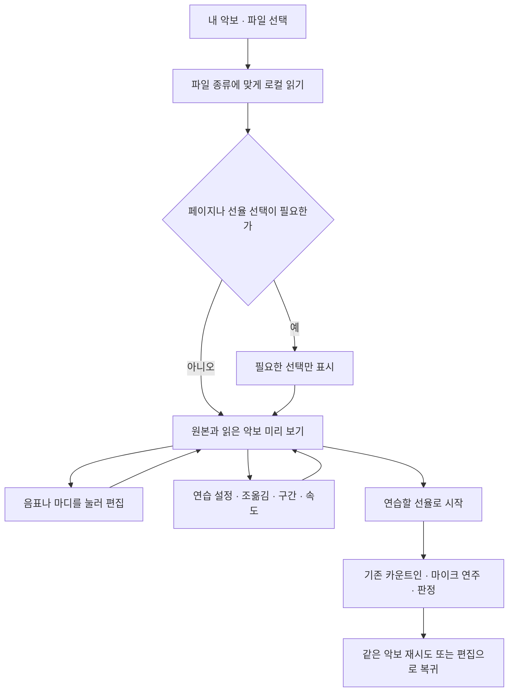

# 내 악보 불러오기와 멜로디 연습

**현재 앱** — `멜로디 연습 → 내 악보`에서 MusicXML, MuseScore, MIDI 파일을 이 기기에서 읽는다. 총보에서 마디를 찾아 수정하고, 선택한 성부의 음과 겹음을 미리 듣거나 마이크로 연습한다. 파일과 편집 이력은 이 탭의 메모리에 둔다.

PNG·JPEG·PDF의 인쇄 악보는 한 줄씩 골라 읽을 수 있다. 수정본 내려받기와 전문 조판은 후속 설계다. 아래에서는 현재 연습에 쓰는 기보와 더 넓은 편집기의 목표를 구분한다.

## 제품 범위와 기본 결정

- 요구된 `서버 저장 없음`을 구현 기본값에서는 **파일 본문을 서버로 전송하지 않는 기기 내 처리**로 정한다. 로컬 파일 선택 UI를 사용하며 파일 저장 API를 만들지 않는다.
- MusicXML/MXL 같은 구조화 파일과 사진·스캔 PDF 모두 목표 범위에 포함한다. MusicXML을 읽는 기능만 완성하고 사진/PDF 인식까지 끝났다고 하지 않는다.
- 겹음은 구성음 전부가 한 번에 들려야 통과한다. 성부가 여럿이면 연습할 파트·보표·성부를 고른다. 총보에는 다른 파트도 남는다.
- 원본 악보의 음정·음가·쉼표·붙임줄과 문맥을 보존한다. 지원하지 못하는 내용을 첫 마디의 박자·조표로 뭉개거나 임의 음표로 메우지 않는다.
- 멜로디 화면과 기존 마이크·피아노 음원을 재사용한다. 가져온 악보의 판정기는 겹음과 마디별 문맥을 처리한다.
- 이미지 인식은 앱에 포함된 규칙 기반 Web Worker에서 수행한다. 더 넓은 기보를 인식할 모델은 아래 기술 검증을 거쳐 선정한다.

## 파일별 처리와 구현 순서

| 입력                | 읽는 방법                              | 의미                                                         |
| ------------------- | -------------------------------------- | ------------------------------------------------------------ |
| `.musicxml`, `.xml` | 악보 구조 파서                         | 음표·마디·성부가 이미 들어 있는 데이터를 읽음                |
| `.mxl`              | 컨테이너 해제 후 MusicXML 파싱         | 압축된 구조 악보. 이미지가 아님                              |
| `.mscx`, `.mscz`    | MuseScore의 주 악보에서 파트·보표·성부와 기보를 읽어 MusicXML로 변환 | 압축 파일 안의 스타일이나 발췌 파트는 총보와 구별한다. |
| `.mid`, `.midi`     | Standard MIDI File의 트랙·채널과 음의 시작·종료 시각을 읽어 MusicXML로 변환 | 음높이와 연주 타이밍을 살리고, 화면에 그릴 음가와 음이름 표기를 추정한다. |
| PDF                 | 선택 페이지를 이미지로 렌더링한 뒤 OMR | PDF를 열거나 글자를 추출하는 것만으로 음표가 인식되지는 않음 |
| PNG/JPEG 등 이미지  | 방향·기울기·영역 정리 후 OMR           | 인쇄 오선 악보를 구조 데이터로 복원                          |

OMR은 Optical Music Recognition이다. 일반 문자 OCR이나 범용 이미지 설명 결과를 그대로 정답 악보로 쓰지 않는다.

### 2A — 구조화 파일과 공통 연습 기반

파일을 여는 경계에서 형식별 읽기 전략을 선택한다. 확장자는 파일 선택기에 사용하고, 실제 판별에는 MIDI 헤더, 압축 컨테이너, XML 문서의 루트 요소를 사용한다. MusicXML 전략은 기존 문서를 반환한다. MuseScore와 MIDI 어댑터는 공통 작성기로 편집 가능한 MusicXML 문서를 만든다. 이 지점부터 세 형식 모두 같은 파서, 음표 편집 명령, 실행 취소, 연습 시간표를 사용한다.

MuseScore 2~4 계열 파일에서 음·쉼표·겹음, 보표·성부, 이조악기, 박자·조표·템포, 잇단음·붙임줄과 반복 기호를 변환한다. MSCZ에서는 주 악보와 별도의 스타일에 기록된 실음 보기와 스윙 설정도 읽는다. 현재 연주할 수 없는 전역 스윙이나 구버전 형식은 MusicXML로 내보내 다시 여는 방법을 안내한다. 고유한 페이지 배치와 장식의 재현 범위는 원본 편집기와 다를 수 있다. [MuseScore 파일 형식](https://handbook.musescore.org/file-management/opening-and-saving-scores)

MIDI는 박 단위로 기록한 SMF 형식 0과 1을 지원한다. 트랙·채널별로 연습할 파트를 나누고 겹음의 각 음이 끝나는 시각, 서스테인 페달, 박자·조표·템포 변화를 반영한다. 박자 정보가 없으면 4/4, 템포 정보가 없으면 분당 120박으로 시작한다. 연주 미세 타이밍은 유지하며 표기용 음가만 추정한다. 타악기 채널은 선율 연습에서 제외한다. 피치 벤드나 MIDI 조율 변경으로 음높이가 달라지는 파트·마디는 안내 후 연습을 제한한다. 독립 시퀀스가 있는 형식 2와 프레임 단위 SMPTE 타이밍은 지원 범위 밖이다. [Standard MIDI Files](https://midi.org/standard-midi-files)

설치된 alphaTab 1.9.0의 공개 `ScoreLoader.loadScoreFromBytes`로 같은 한 음의 XML과 압축 MXL을 읽어 음과 첫 페이지 제목이 일치하는 것을 확인했다. 같은 입력의 두 번째 페이지 `credit-words`는 변환된 모델에서 빠졌다. 따라서 표시용 라이브러리 모델로 파일 전체를 다시 만들면 편집하지 않은 기호도 잃을 수 있다.

### MusicXML에서 표현할 내용

이번 구현의 기준은 **적힌 음과 박, 방문 순서를 연주할 수 있는가**다. 성부별 음·쉼표·겹음, 조표·임시표·음자리표·이조악기, 박자·템포, 잇단음의 실제 음가, 붙임줄, 도돌이표와 1·2번 괄호, 지원하는 D.C./D.S.·코다·Fine가 여기에 들어간다. 겹음은 음머리별 끝 시각도 읽는다. 악보를 단순화해서 다른 정답으로 채점할 위험이 있는 기호는 해당 마디와 함께 안내하고 영향을 받는 구간의 연습을 제한한다. 셈여림·일부 주법은 기보에 보존하며 현재 음높이·리듬 채점에 포함하지 않는다.

아래 표는 장기적으로 악보 요소를 직접 고칠 수 있게 할 때의 편집 방식과 검증 기준이다. 제목·페이지 이미지·특수 주법까지 모두 편집할 수 있다는 출시 범위가 아니다.

| 대상 | 악보에서 고치는 방법 | 대표 검증 |
| --- | --- | --- |
| 음·쉼표·겹음, 음가·기둥·빔·잇단음 | 음머리 드래그, 자리 선택, 묶음 괄호의 속성 | 같은 박의 두 머리를 따로 조작하고 겹잇단음의 시간과 괄호를 복원 |
| 조표·박자·음자리표, 마디선·반복·1·2번 괄호 | 기호나 경계 클릭, 적용 보표·범위 선택 | 중간 박자 변화와 반복 방문 순서, 보표별 음자리표를 보존 |
| 붙임줄·이음줄·헤어핀·글리산도·페달·옥타브선 | 선을 누르고 양끝을 음 또는 박에 붙임 | 한쪽 끝을 옮긴 뒤 원래 파트·성부 및 양끝의 관계 유지 |
| 셈여림·주법·꾸밈음·템포, 가사·코드명·지시어 | 해당 기호·텍스트를 눌러 값, 절·음절, 위치 수정 | 글자를 고쳐도 다른 절·성부에 옮겨 붙지 않음 |
| 타브·타악기·운지·코드 도표, 특수 음머리 | 보표 종류에 맞는 줄·프렛·악기·모양 선택 | 일반 오선 음높이로 일괄 변환하지 않고 해당 표기로 재표시 |
| 제목·페이지 글자·이미지·줄바꿈·보표 간격 | 페이지 위 요소나 여백을 눌러 내용·정렬·위치 조정 | 2쪽 글자와 MXL 내부 그림을 둔 채 1쪽 음 하나를 바꿔 재개봉 |

편집은 처음 불러온 악보 문서의 복사본에서 해당 요소를 바꾸는 방식이다. MusicXML/MXL에서는 원래 XML의 요소 순서·속성·참조를 보존한다. MuseScore와 MIDI의 ‘편집 전 악보’는 처음 변환한 기보다. 세 형식 모두 원본 파일을 탭에 보관하고 같은 편집본에서 기보와 연습 데이터를 얻는다. MXL은 `META-INF/container.xml`의 주 악보를 찾아 읽는다. 페이지 글자는 원래 쪽별로도 확인할 수 있다. 내부 그림의 원위치 조판과 여러 작품을 담은 `opus` 선택은 후속 범위다. [MusicXML 4.0](https://www.w3.org/2021/06/musicxml40/) · [MXL 컨테이너](https://www.w3.org/2021/06/musicxml40/tutorial/compressed-mxl-files/)

기호별 지원표에는 실제 파일, 그려진 위치와 원소 ID, 지원하는 편집 명령, 편집 전후 비교 결과를 둔다. 미구현 항목은 파일의 위치와 종류를 알려 주고 원본을 보존한다. 기호를 화면에서 직접 고친 증거가 있을 때 해당 항목을 완료로 표시한다. 표준에 없는 제작사 확장은 원문·자산을 보존하고 공개된 의미와 예제가 있을 때 표시·편집 지원을 추가한다.

### 2B — 사진/PDF 인식 기술 검증

`멜로디 연습 → 내 악보`에서 PNG·JPEG 또는 PDF를 연다. 여러 페이지가 있는 PDF는 연습할 페이지를 고른다. PDF.js와 필요한 자산은 앱과 같은 호스팅에서 제공하고 선택한 페이지를 브라우저에서 그린다. 암호가 필요한 PDF는 잠금을 해제한 사본을 사용한다. 위·아래 경계를 조절해 인쇄 오선 한 줄과 음표 기둥을 포함한 뒤 **선택한 오선 읽기**를 누른다. 원본과 마디별 결과를 비교하고 편집기로 넘긴다. 편집 중에도 **인쇄 원본**을 펼쳐 확인할 수 있다.

높은음자리표와 낮은음자리표, 올림·내림 조표, 숫자 박자표(2/2·3/4·4/4·6/8 등)와 기호 𝄴·𝄵를 읽는다. 첫머리가 잘린 오선은 빠진 음자리표·조표·박자를 원본에서 확인해 선택한다. 조표는 음이름에, 임시표(♯·♭·♮)는 해당 마디의 같은 높이에 적용한다. 마디 길이는 선택한 박자와 대조한다.

음역은 높은음자리표 C4~A5, 낮은음자리표 E2~C4다. 온·2분·4분·8분음표와 쉼표, 점 하나가 붙은 음가, 한 줄로 연결된 8분음표와 단순한 겹음을 읽는다. 겹음에서는 노래하거나 연주할 음 하나 또는 겹음 전체를 고른다. 원래 음머리는 편집기에 남고 미리 듣기와 채점에는 선택한 음을 쓴다. 오선 위에 따로 인쇄한 코드명은 연주음으로 읽지 않는다. 기울기가 작은 사진은 오선을 수평으로 보정해 다시 읽는다. 여러 성부, 손글씨, 겹보표, 16분음표·복잡한 붙임줄은 대상 범위를 벗어난다.

원본과 선택한 영역은 탭 메모리에서만 처리한다. 32 MiB 이하의 파일에서 이미지 크기를 먼저 확인하고, 최대 2,400만 화소 입력을 400만 화소 이하로 줄여 처리한다. 검증에는 악보 글꼴로 만든 예제와 독립적으로 조판한 예제를 사용한다. 실제 휴대폰 사진의 정확도와 속도는 미측정이다.

2A와 독립적으로 작은 실험을 먼저 진행할 수 있다. 인쇄된 단선율, 여러 조표·임시표·음가·쉼표·붙임줄, 페이지 경계, 회전·촬영 품질을 포함한 자료로 브라우저 실행·정확도·시간·메모리를 확인한다.

첫 목표는 선명한 인쇄 오선 악보다. 손글씨, 심한 원근 왜곡, 임의의 복잡한 피아노 전곡까지 같은 정확도를 약속하지 않는다. 후보가 기기 내 처리와 성능 기준을 충족하지 못하면 사진/PDF를 일반 기능으로 출시하지 않고 엔진 선택을 다시 검토한다. 외부 모델 API로 파일을 보내는 자동 fallback은 두지 않는다.

### 2C — 인식 결과 확인과 연습 연결

검증한 OMR 출력도 2A와 같은 정규 악보로 변환한다. 사진/PDF에서는 원본 조각과 확인할 마디 위치를 제공한다. 음표를 고치고 연습하는 조작은 MusicXML을 열었을 때와 같다.

기능 2의 완료는 2A뿐 아니라 2B·2C의 대상 인쇄 악보까지 검증한 시점이다. 단계별로 배포하더라도 지원 파일 유형을 실제 상태에 맞게 표시한다.

## 화면 흐름

- 멜로디 연습에는 `생성 멜로디`(`/melody/generated`)와 `내 악보`(`/melody/upload`) 두 하위 화면이 있다. 기존 `/melody` 주소는 생성 멜로디로 이어진다. 두 화면을 오가면 마이크와 재생은 정지한다. 내 악보의 수정본·실행 취소 이력·연습 설정은 같은 탭에서 화면이나 표시 언어를 바꿔도 유지되며, 멜로디 연습을 떠나면 해제한다.
- 생성 멜로디의 **악보 편집**은 화면에 있는 바로 그 곡을 연다. 생성 시의 조성·템포·음가·코드 진행을 가져오고, 이후에는 업로드 악보와 같은 명령으로 편집하고 연습한다. **생성 원본 보기**를 눌러 원래 연습으로 돌아가도 편집본을 다시 열 수 있다. 생성곡과 업로드 파일에는 각각 별도의 실행 취소 이력이 있다.
- 내 악보에서 파일을 선택하거나 놓으면 편집기를 연다. 데스크톱의 설정 열과 모바일의 설정 창에서 음자리표·박자표를 직접 바꿀 수 있다.
- 파일 하나를 고르면 미리 보기를 먼저 제공한다. 선택 성부가 하나라면 성부 선택 단계를 생략한다.
- PDF는 선택한 페이지의 원본을 보여준다. 다른 페이지로 이동하면 선택 영역과 인식 결과를 초기화한다.
- 구조화 파일에는 인식 모델 다운로드·사진 보정 같은 단계를 보이지 않는다.
- 원본 비교는 펼쳐서 확인할 수 있게 한다. 사진 인식 결과에서 필요한 부분만 원본 조각과 나란히 볼 수 있다.
- 성공 배너·기술 설명·사용법 카드·여러 확인 체크박스를 반복하지 않는다. 파일 옆에 필요한 경우 `이 기기에서만 처리됩니다` 정도의 짧은 설명만 둔다.
- 작업 중에는 `악보 읽는 중`, 실제 처리한 `2/4페이지` 등 현재 행동에 필요한 상태만 표시한다. 근거 없는 진행률·완료 시간·정확도 수치를 보여주지 않는다.

## 악보에서 바로 편집하기

한 줄 보기에서 음머리 드래그, 겹음 추가·부분 삭제·쉼표 전환, 음가와 임시표, 길게 눌러 다른 박으로 이동, 잇단음 만들기·풀기, 붙임줄, 마디 반복, 음자리표·박자 변경, 실행 취소를 사용할 수 있다. 데스크톱과 휴대폰은 같은 편집 규칙을 쓴다. 아래의 긴 곡·사진 인식 조작 예시는 편집 범위를 넓힐 때의 설계도 포함한다.

MusicXML·MXL에 적힌 X자 음머리는 전체 보기와 한 줄 보기에 표시된다. 한 줄 보기에서 **음머리 → 기본 / X**를 고르면 겹음 안에서도 선택한 음 하나의 모양만 바뀐다. 무음고 음표도 악보에 적힌 오선 위치에서 선택할 수 있다. [X자 음머리 표시·편집](rhythm-reading.md)

파일을 열면 `한 줄 보기`에서 선택한 성부의 모든 마디가 가로로 이어진다. 준비 중에는 좌우로 스크롤하고, 미리 듣기와 연습 중에는 악보가 연주선을 따라 흐른다. `전체 보기`는 여러 파트를 함께 표시하고 네 번째 시스템부터 악보 안에서 세로로 스크롤한다. 피아노 양손처럼 함께 읽는 보표는 한 시스템으로 센다. 여기서 마디를 누르면 한 줄 보기의 같은 위치로 이동한다. `원본 악보`를 켜면 파일을 열었을 때의 총보를 볼 수 있다. 실행 취소·다시 실행과 연습 컨트롤은 악보 아래에 둔다. 조옮김·옥타브·속도·연습 구간은 기존 `연습 설정`에 둔다. 음표를 한 번 누르면 해당 자리에서 편집을 시작한다.

- **데스크톱**에서는 음머리를 누른 채 위아래로 끌어 음을 고친다. 클릭해서 선택하면 옆에 `+`와 작은 도구 창이 열린다. 도구 창은 선택한 기호 주변에 겹쳐 열리고 악보와 아래 조작부의 위치는 유지된다. 창에는 선택한 음이름·길이와 해당 자리에서 쓸 수 있는 동작을 보여준다. 음자리표·박자표를 클릭하면 그 기호 옆에 선택 목록이 열린다.
- **휴대폰**에서는 같은 도구가 화면 하단에서 올라온다. 악보와 시트는 별도로 조작한다. 패널을 열어 둔 채 다음 음을 누르거나 악보를 쓸어 넘길 수 있다. 선택한 마디와 패널의 버튼은 하단 광고·기기 여백 위에 놓는다. 촘촘한 음은 마디를 확대하거나 패널의 `이전 음`·`다음 음`으로 고른다.
- **키보드**로는 좌우 방향키로 자리를 찾고 음머리를 골라 위아래 방향키로 오선 한 자리씩 옮긴다. Enter로 도구를 열고 Esc로 선택한 기호에 돌아온다. `+`의 접근 가능한 이름은 `겹음 추가`다. 겹음의 구성음 목록에서는 키보드나 터치로 정확한 음을 선택할 수 있다. 선택한 음에만 윤곽선과 음이름을 표시한다.

### 선택한 대상에 따라 보이는 도구

| 선택 대상 | 사용자 조작 | 악보에서 보이는 결과 |
| --- | --- | --- |
| 음표 하나 | `길이`에서 온·2분·4분·8분·16분음표나 점을 선택 | 기호와 이름을 함께 표시한다. 4분음표를 8분음표로 줄이면 바로 뒤에 8분쉼표가 생긴다. |
| 음표 또는 쉼표 | 음표는 `쉼표로` 한 번에 바꾼다. 쉼표는 `음표 넣기`를 누르고 오선이나 음높이 버튼에서 음을 고른다. | 같은 시작 위치와 길이에서 바뀐다. 음 하나를 더 이어 쓸 때는 `추가 → 뒤에 넣기`로 뒤 쉼표에 넣거나, `둘로 나누기`로 선택한 음의 뒤 절반에 새 음을 넣는다. |
| 음머리 하나 | 음머리를 직접 위아래로 끌고 놓는다. | 해당 음만 바로 위·아래의 줄이나 칸에 붙는다. 드래그 중에 예상 음이름을 보여주고 놓을 때 한 번 확정한다. 같은 자리에 있는 다른 음과 시작 박은 유지한다. |
| 음머리 옆 `+` | 한 번 눌러 같은 시작점·같은 길이의 음을 쌓는다. | 처음에는 현재 조에서 선택한 음의 3도 위를 제시한다. 이미 있는 음이면 그 위의 비어 있는 3도 후보를 쓴다. 새 음머리가 선택돼 곧바로 끌 수 있다. |
| 박 위치 | 음머리를 길게 누른 뒤 좌우로 끌어 표시된 박에 놓는다. 키보드는 Shift와 좌우 화살표, 선택 창에서는 `박 이동`을 쓴다. | 같은 성부의 다른 마디까지 겹음 전체를 옮긴다. 쉼표에 놓으면 빈 시간을 채우고, 음표에 놓으면 두 음의 자리를 바꾼다. |
| 한 자리 또는 연속된 음 | 한 음·쉼표에서 `잇단음`을 열거나, 첫 음의 `범위 선택`을 누르고 끝 음을 고른다. 데스크톱에서는 Shift+클릭도 쓴다. | 같은 창에서 선택한 자리를 나누거나 이미 적은 음들을 묶는다. 적용 전 오선에 변경될 괄호·음·쉼표를 보여준다. |
| 음자리표·박자표 | 데스크톱은 기호 옆 목록, 모바일은 악보 아래 선택 패널에서 바꾼다. `설정`에서도 같은 항목을 연다. | 두 경로 모두 같은 마디와 보표에 같은 편집 명령을 적용한다. |
| 마디 번호 또는 마디선 | 첫 마디와 끝 마디를 고르고 `기호 → 도돌이표`를 누른다. 한 마디만 고를 수도 있다. | 양끝 기호를 한 쌍으로 넣는다. 기본은 총 두 번 연주다. 예를 들어 2~3마디를 고르면 `2 → 3 → 2 → 3`을 먼저 보여준다. 쌍을 누르면 횟수 변경·제거가 가능하다. |

`더 보기`에는 선택한 음에 적용할 ♯·♭·♮와 붙임줄을 둔다. 붙임줄은 같은 성부에서 이어지는 같은 음높이 두 개를 선택했을 때 연결할 수 있다. 마디 도구의 첫 범위는 단순 도돌이표다. 1·2번 괄호, 세뇨·코다 삽입은 해당 기호의 실제 연주 순서까지 검증한 뒤 확장한다.

### 겹음을 지우거나 쉼표로 바꿀 때

- 도·미·솔에서 미를 골라 `이 음 빼기`를 누르면 도·솔이 남는다. 한 성부에서 함께 울릴 음이 남아 있는 동안에는 그 자리에 쉼표를 겹쳐 쓰지 않는다.
- 단음에서는 `쉼표로`, 겹음에서는 `겹음 전체를 쉼표로`라고 쓴다. 마지막 음머리를 빼는 것도 같은 동작이다. 쉼표는 그 자리가 차지하던 시간만큼 생긴다. 네 음을 동시에 쳤더라도 쉼표 네 개가 생기지 않는다.
- 다른 길이의 음이 겹친 파일에서는 각 음의 끝과 다음 시작 박을 따로 보존한다. 2분 도와 4분 미 중 도만 빼면 4분 미 뒤에 4분쉼표가 남는다. 전체를 바꾸면 2분쉼표가 된다. 다른 성부, 잇단음 안의 자리, 마디의 길이는 유지한다. 없어진 음의 붙임줄은 양끝을 정리하고 한 번의 실행 취소로 모두 복원한다.

### 잇단음은 ‘몇 개를 어느 시간에 넣을지’로 고른다

잇단음 도구는 3:2·4:3·5:4 같은 비율과 직접 지정을 제공한다. 4:3은 같은 음가 네 개를 보통 세 개 길이에 연주한다는 뜻이다. 직접 지정에서는 두 숫자를 바꾸며, 선택한 자리나 범위에서 기준 음가와 점을 계산해 적용 전에 보여준다. 2:3·7:4 같은 비율도 같은 동작을 쓴다. 넷잇단음의 비율은 악보의 문맥에 따라 고를 수 있다.

| 시작점 | 적용 예 | 이후 박 |
| --- | --- | --- |
| 한 음 또는 쉼표 | 4분쉼표를 3:2로 나누면 8분 셋잇단쉼표 세 자리, 6/8의 점4분쉼표를 4:3으로 나누면 8분 넷잇단쉼표 네 자리가 생긴다. 음에서 시작하면 첫 자리에 그 음을 둔다. | 처음 선택한 길이를 채운다. 현재 길이와 기준 음가가 맞지 않으면 필요한 범위를 짚어 준다. |
| 이미 입력한 연속 음 | 일반 8분음표 네 개를 4:3으로 묶으면 같은 음들이 이제 8분음표 세 개의 시간에 울리고, 맨 뒤에 8분쉼표 하나가 남는다. | 다음 음의 시작을 보존한다. 늘어나는 비율은 바로 뒤 여유 쉼표로 채울 수 있을 때 적용한다. |

겹음은 리듬 자리 하나로 세고 쉼표도 묶음에 포함한다. `묶음 풀기`는 복구할 음가와 필요한 자리를 미리 보여준다. 그룹 생성·해제는 각각 실행 취소 한 번이다. 가져온 악보의 혼합 음가·점을 포함한 기준음·겹잇단음은 정확한 분수 시간, 묶음 시작·끝과 층, 숫자·괄호 표시를 함께 보존한다. 실제 시간은 MusicXML의 duration/divisions에서 한 번만 읽고, 적힌 음가와 비율로 그 시간을 다시 줄이지 않는다. [MusicXML 시간 비율](https://www.w3.org/2021/06/musicxml40/musicxml-reference/elements/time-modification/) · [잇단음 표기](https://www.w3.org/2021/06/musicxml40/musicxml-reference/elements/tuplet/)

### 한 음을 고칠 때 지켜야 할 박

편집의 기본값은 **다음 음이 원래 박에서 시작하게 하는 것**이다. 길이를 늘리거나 뒤에 음을 넣을 때는 같은 마디의 바로 뒤 쉼표에서 필요한 길이만 쓴다. 음표를 옮길 때는 놓을 자리를 미리 표시한다. 같은 마디 안에서는 길이가 다른 음도 음가를 유지하며 자리를 교환한다. 마디를 넘겨 다른 음가와 바꿀 때에는 짧은 쪽 뒤의 쉼표로 필요한 시간을 조정한다. 붙임줄 등 연결 기호나 남은 길이 때문에 옮길 수 없으면 기존 자리를 유지하고 `뒤에 8분쉼표가 필요해요`처럼 이유를 보여준다. 박이 찬 마디에서는 절반 길이를 표기할 수 있는 음을 `둘로 나누기`로 나눈다. 못갖춘마디에는 그 마디의 실제 길이를 적용한다.

휴대폰에서도 음머리 위에서 시작한 세로 드래그는 바로 음높이를 바꾼다. 오선의 빈 곳은 스크롤과 확대에 쓰고, 빠르게 가로로 쓸면 악보가 스크롤된다. 음머리를 길게 눌러 잡은 뒤 옆으로 끌면 박 이동이 시작된다. 놓기 전 취소하거나 터치를 잃으면 원래 음으로 돌아간다. 겹음 속 다른 음과 같은 음높이에 놓으려 하면 기존 음들을 유지하고 다른 위치를 고를 수 있게 한다. 붙임줄로 연결된 음의 높이를 바꾸면 연결된 같은 음도 따라간다. 한쪽만 바꾸려면 붙임줄을 먼저 풀 수 있다.

### 악보에서 조성·음자리표·박자표 고치기

마디 번호나 도구줄의 **마디 기호**를 누르면 조성·음자리표·박자표를 고를 수 있다. 기호가 이미 적힌 곳에서는 기호를 직접 누른다. 마디 안의 특정 박에 조성이나 음자리표를 넣으려면 그 음 또는 쉼표를 선택하고 **마디 기호**를 연다. 설정에서도 **이 마디부터**로 편집할 마디를 고를 수 있다. 곡 첫머리는 1마디를 선택한다.

- 음자리표를 바꾸면 해당 보표의 음머리를 새 위치에 그린다. 도4는 어떤 음자리표에서도 같은 도4로 들린다. 가져온 중간 음자리표는 원래 시점까지 다룬다.
- 조성은 선택 위치에서 해당 보표의 다음 명시 조표 직전까지 적용한다. 기본값은 음높이 유지다. **음도 함께 조옮김**을 선택하면 두 으뜸음 사이의 가장 가까운 음정만큼 모든 성부와 코드명을 옮긴다. 앞뒤 음높이가 달라진 경계의 붙임줄은 끊고 그 지점에서 새 음을 낸다. **연습 조성**은 악보와 별개로 연습 구간 전체에 적용하는 설정이다.
- 한 줄 악보의 박자표는 생성 멜로디와 같은 Bravura 글꼴의 악보용 숫자를 쓴다. 모바일 도구 창은 아래에서 열리고 아래로 끌어 닫을 수 있다. 기기의 모션 줄이기 설정을 따르며, 음높이 드래그와 재생 커서는 박에 맞춰 즉시 움직인다.
- 전체 보기에서는 모든 파트에서 음이 맞닿는 박을 기준으로 표시용 악보를 나눠 마디 안의 변경을 그린다. 원래 마디 번호와 연습 시간표는 유지한다. 다른 성부의 지속음 등을 가로질러 나누기 어려운 경우에는 해당 마디에 **마디 기호**를 표시하고 정확한 한 줄 악보로 연결한다.
- 박자표는 선택한 마디부터 다음 명시적 박자 변화 전까지 적용한다. 새 마디 길이로 파트·성부를 함께 나눠 남은 음과 쉼표를 다음 마디로 보낸다. 경계를 넘는 지속음은 붙임줄로 이어 한 번만 소리 낸다. 예를 들어 4/4로 가득 찬 두 마디를 3/4로 바꾸면 3박·3박·2박이 된다. 도돌이표나 못갖춘마디의 경계에 필요한 짧은 마디는 보존한다. 실행 취소 한 번으로 음과 마디선을 함께 복원한다.
- 폭이 좁으면 두 설정 모두 악보 아래 패널에 열고 바뀔 마디를 계속 보여준다. 미리 보는 동안 문서는 그대로이며, 박자 재배치까지 한 번에 되돌릴 수 있다.

### 고친 것을 확인하는 방법

`이 마디 듣기`는 지금 편집하는 마디를, `미리 듣기`는 설정한 구간을 들려준다. 두 경우 모두 편집한 성부의 겹음과 조옮김·속도를 반영한다. `원본`에서 파일을 열었을 때의 총보와 비교할 수 있다. 음이나 마디에 가한 편집 한 번은 한 단계로 되돌리거나 다시 실행한다.

## 연습 옵션

기본 화면은 악보와 핵심 조작을 우선한다. 자주 쓰지 않는 옵션은 기존 설정 표면 안에 둔다. 원본에 해당 정보가 없거나 선택지가 하나이면 관련 선택기를 만들지 않는다.

| 옵션             | 초기 동작                                   | 변경 결과                                   |
| ---------------- | ------------------------------------------- | ------------------------------------------- |
| 성부             | 파트·보표·성부 조합이 여럿이면 선택         | 선택한 성부의 겹음 구성음을 모두 듣고 판정 |
| 연습 구간        | 처음에는 선택한 성부의 전곡, 시작·끝 마디 선택 | 두 마디 사이에 적힌 구간을 준비·연주 |
| 조옮김           | 원하는 실음 조 또는 반음 단위로 –24에서 +24까지                | 원본을 유지하고 연습 표시·소리·목표음을 함께 이동 |
| 옥타브           | 한 옥타브 내리기·올리기               | 선율 전체가 한 옥타브 이동 |
| 속도             | 원본 템포 100%, BPM 직접 입력 또는 배율 조절                   | 원본의 템포 변화 전체에 같은 배율 적용      |
| 음자리표         | 설정 또는 보표의 현재 기호를 눌러 변경      | 같은 구간의 보표 위치만 바뀌고 실음은 유지  |
| 박자표           | 설정 또는 마디의 현재 기호를 눌러 변경      | 영향받는 마디를 확인한 뒤 박자·마디선·준비 박에 함께 적용 |
| 준비 박·메트로놈 | 준비 박과 연습 중 메트로놈·마디 첫 박 종소리 | 속도·박자 변화에 맞춰 연주와 미리 듣기에 반영                  |
| 미리 듣기·재시도 | 기존 방식 사용                              | 현재 선택·변환 결과를 유지                  |

여기서 `조옮김`은 같은 음악을 다른 높이로 옮기는 일이다. 곡 안의 조바꿈은 원본 문맥으로 보존한다. 장조 곡을 단조로 재작곡하거나 원본에 없는 코드 진행을 추측해 넣는 기능은 포함하지 않는다.

조옮김은 편집본의 실음 조를 기준으로 한 음정 하나로 관리한다. 편집할 때도 **화면에서 보고 듣는 음**을 고친다. 예를 들어 C장조 악보를 D장조로 올린 상태에서 화면의 레를 미로 고치면, 원조로 돌아갔을 때 그 자리에는 레가 남는다. 변경한 음의 철자와 높이만 현재 음정·옥타브를 거꾸로 적용해 편집본에 기록한다. 설정을 바꿀 때마다 이 편집본에서 다시 표시하므로 조옮김을 여러 번 해도 누적되지 않는다.

악보에 템포가 없으면 72 BPM을 기준으로 한다. 원본 속도의 50~200%를 선택할 수 있고, 곡 중간의 템포 변화에도 배율을 적용한다.

도·미·솔이 적혀 있으면 세 음이 함께 감지되어야 통과한다. 미리 듣기도 세 음을 함께 울린다. 도·솔만 울리거나 도→미→솔을 하나씩 연주하면 실패다. 음 사이를 오가며 수집한 별개 검출 결과를 하나의 겹음으로 합산하지 않는다.

겹음의 음가가 다르면 울려야 할 음의 집합이 악보에 적힌 시점에서 바뀐다. 예를 들어 2분 도와 4분 미가 함께 시작하면 첫 박은 도·미, 다음 박은 계속 울리는 도다. 붙임줄이 이어지는 도를 다시 칠 필요는 없다. 구간 전체가 쉼표면 음표가 있는 구간을 골라 시작할 수 있다. [MusicXML 4.0 겹음 표기](https://www.w3.org/2021/06/musicxml40/musicxml-reference/elements/chord/)

선택 구간 자동 반복은 공통 연습 기반 뒤에 연결할 옵션이다. 첫 연결은 기존 재시도로 완성한다. 자동 반복을 추가할 때는 회차별 새 attempt/판정 기록과 준비 박을 만들고 파일 파싱·OMR은 재실행하지 않는다. 여러 회차를 하나의 이벤트 목록에 누적해 과거 판정을 재사용하지 않는다.

## 현재 코드의 데이터 흐름

1. `readScoreFile`이 XML이나 MXL 안의 주 문서를 읽는다. `ImportedScore`는 XML 트리, 파트·보표·성부별 마디, 개별 음머리의 철자·실음·음가, 해석에 주의할 기호의 위치를 담는다. MXL 읽기는 파일 크기와 압축 해제 한도를 검사한다.
2. 한 줄 보기 편집기는 설정과 직접 조작을 같은 편집 명령으로 보낸다. 한 명령이 XML 복사본을 수정하고 다시 색인하는 동안 원본과 현재 악보는 유지된다. 성공하면 새 편집본을 반영한다. 실행 취소·다시 실행은 같은 변경을 묶어 복구한다.
3. `prepareScore`가 선택한 성부·연습 구간·반복 설정에서 마디 방문 순서를 구하고, 마디와 마디 안의 템포를 반영해 초 단위로 변환한다. `ImportedTimeline`은 미리 들려줄 개별 음, 각 시점에 함께 울려야 할 실음 목록, 마디 방문 시각과 준비 박을 담는다.
4. 마이크 세션은 앱의 기존 `ChallengeAudioSession`을 사용한다. 시간표에 맞춰 단음·쉼표·겹음을 판정하고, 반복 방문마다 별도의 결과를 남긴다. 음원 미리 듣기에는 마이크 권한이 필요하지 않다.

생성 원본은 단선율 세션을 사용하고 편집한 생성곡은 내 악보와 같은 연습 세션에서 재생·채점한다. 향후 사진 인식까지 연결할 때에는 구조화 파일에서 검증한 마디 문맥, 템포 지도, 음머리별 목표음과 표기 참조를 공통 모델의 기준으로 삼는다.

## 표기와 판정이 갈라지기 쉬운 경우

### 붙임줄과 같은 음 반복

C4 2분음표 두 개가 붙임줄로 이어지면 미리 듣기에서 한 번만 울리고 마이크도 두 번째 어택을 요구하지 않는다. 마디 표시는 두 마디의 각 방문 시각을 따른다. 같은 높이라도 붙임줄이 없는 반복음은 다시 연주해야 한다. 구간이 붙임줄 중간에서 시작하거나 끝나면 이번 연습의 시작·끝에 맞춰 지속 시간을 자른다. 원본 파일에는 양쪽 표기가 남는다.

### 조옮김·악곡 내 조바꿈·이조악기

전곡에 같은 음정을 적용하되 각 마디의 조표·임시표 철자를 함께 바꾼다. 곡 중 C장조→G장조가 있는 악보를 장2도 올리면 D장조→A장조로 보존한다. 같은 음고라는 이유로 모든 임시표를 임의의 sharp 표기로 통일하지 않는다.

MusicXML의 이조악기 정보도 보존한다. 첫 연습 화면은 실음 악보로 통일해 **화면에 보이는 음높이·미리 듣기·마이크 목표음이 같은 기준**이 되도록 한다. 이조악기인 경우 확인 화면에서 실음 변환 상태를 짧게 표시한다. 원본 표기음은 그대로 두고 다른 실음을 마이크 목표로 쓰는 악기별 연습 모드는 후속 범위다.

이 경우 조옮김 옵션의 `원조`는 불러온 실음 악보의 조를 뜻한다. 원본 파일의 악기용 표기와 혼동하지 않게 하고, 원본 비교에는 파일의 표기를 그대로 보여준다.

### 못갖춘마디·박자·속도 변화·반복

- 못갖춘마디를 완전한 마디로 만들려고 앞에 임의 쉼표를 넣지 않는다. 실제 길이를 보존하고 시작 카운트인을 해당 박자에 맞춘다. 준비 박이 32번을 넘는 특수 박자에서도 최대 32번까지만 세며 연주할 마디의 길이는 그대로다.
- 중간의 조·박자·음자리표·템포 변화는 마디 문맥과 시간표에서 처리한다. 먼저 나타난 값 하나로 평탄화하지 않는다.
- 단순·중첩 도돌이, 1·2번 괄호, 지원하는 D.C./D.S.·코다·Fine의 방문 순서를 해석한다. 처리할 수 없는 점프는 위치를 알려 준다.
- 새 도돌이표는 기본 두 번 연주하며 횟수를 바꿀 수 있다. 이미 같은 쌍이 있으면 그 설정을 열고, 서로 겹치거나 포개질 범위를 고르면 충돌하는 마디를 짚어 기존 쌍을 수정할 수 있게 한다.
- 기본값은 `반복 기호 따르기`다. 설정에서 끄면 악보에 적힌 마디를 차례대로 한 번씩 연주한다. 반복한 마디는 매 방문마다 새로 판정한다.
- 큰 악보의 모든 반복을 미리 무제한 확장하지 않는다. 기존 탐색 상한과 실제 연습 구간을 기준으로 준비한다.

## 파일 수명주기와 오류 처리

파일 작업은 `idle → reading → review/ready`, 실패 시 `error` 정도의 상태로 관리한다. PDF의 페이지 처리와 OMR은 reading 내부 단계이며 각 단계마다 전역 store를 만들지 않는다.

- 새 파일 선택은 import job ID 하나로 이전 작업을 무효화한다. A 인식 중 B를 고르면 A의 늦은 결과는 적용하지 않는다.
- 취소하면 worker 작업을 중단하고 기존 유효 악보로 돌아간다. 취소를 읽기 실패 toast로 표시하지 않는다.
- B를 읽는 동안 A의 유효 악보를 불필요하게 지우지 않는다. 교체 준비가 끝날 때 한 번에 바꾼다. 교체 중 새 연습 시작은 잠근다.
- 편집은 준비 화면에서 한다. 마이크 권한 대기·미리 듣기·카운트인·연주·일시정지·판정 중에는 현재 파일·악보·연습음을 고정한다. 정지하거나 결과에서 편집으로 돌아오면 같은 파일·마디·편집 이력을 이어 쓴다. 다시 시작할 때는 바뀐 악보로 새 시도를 만든다.
- 파일 닫기·교체·경로 이탈 시 worker, ObjectURL, ImageBitmap, canvas와 bytes/모델 출력 참조를 해제한다. 브라우저가 메모리를 회수할 수 있게 하되 물리 메모리의 완전 소거를 보장한다고 표현하지 않는다.
- 편집본과 실행 취소 이력은 이 탭의 메모리에만 둔다. 편집이 남은 파일을 닫거나 교체할 때는 작업이 사라진다는 사실을 알리고 계속 편집할 수 있게 한다. 교체가 실패하면 기존 편집과 이력을 유지한다. 새로고침하면 다시 파일을 고른다. 후속 후보인 `수정본 내려받기`는 지원 기보를 MusicXML로 내보내 다시 열었을 때 편집이 보존되는지 검증한 후 제공한다.

## 필요한 검증만 입력 경계에 둔다

| 경계                | 필요한 확인                                             | 화면 처리                                    |
| ------------------- | ------------------------------------------------------- | -------------------------------------------- |
| 파일 읽기           | 실제 포맷·파싱 가능 여부, ZIP/이미지/PDF 처리 자원 한계 | 실패한 파일에 대해 이유와 다시 선택만 제공   |
| 정규화              | 올바른 음높이·시간·tie·마디 연결, 원본 문맥 보존        | 위치가 있는 문제는 해당 마디에서 확인        |
| 연습 준비           | 성부·음고·구간·실제 방문 순서와 지원 기보 확인 | 해당 마디를 보여주고 다른 성부나 구간을 선택 |
| 정규 준비 결과 이후 | 신뢰한 타입과 명시한 불변조건 사용                      | 매 프레임·버튼마다 같은 전체 검증 반복 없음  |

파일 크기·페이지 수만으로 필요 이상 차단하지 않는다. 이미지 축소·선택 영역·마디 구간으로 처리할 수 있으면 그 경로를 먼저 쓴다. 다만 압축 해제 폭증, 거대한 canvas, 무한 반복 확장은 실제 중단 원인이므로 자원 한계는 파서 진입점 한 곳에 둔다. 숫자는 기준 기기에서 측정한 예산으로 확정한다.

OMR confidence 하나만으로 성공/실패를 정하지 않는다. 엔진마다 척도가 다르므로 검증 자료로 보정해야 한다. 낮은 확신이나 구조 불일치가 있는 마디를 표시한다. 음높이·음가·쉼표·붙임줄은 공통 도구로, 잘못 읽힌 마디 경계는 원본 조각을 보면서 마디 도구로 고친다.

높은 confidence의 오인식도 가능하다. 기호가 조용히 다른 정답으로 바뀌는 문제를 없애기 위해 원본 비교와 전체 미리 듣기를 제공하되, 모든 음에 확인 체크를 요구하지 않는다. 사용자가 전체 검수를 강제로 끝내야만 시작할 수 있는 흐름은 만들지 않는다.

## 후속 사진·PDF 인식의 성능 설계와 초기 예산

- 파서·PDF 렌더러·OMR 런타임/모델은 `내 악보` 기능을 열 때 lazy-load한다. 일반 멜로디 초기 번들에는 넣지 않는다.
- 무거운 파일 파싱·인식은 전용 worker에서 처리한다. UI와 메시지 경계에는 plain DTO와 필요한 transferable을 사용한다. base64 이미지의 반복 복사를 피한다.
- PDF는 페이지/영역 단위로 순차 처리한다. 전곡의 고해상도 canvas와 중간 tensor를 동시에 보관하지 않는다.
- 같은 파일의 같은 페이지/영역·인식 조건은 한 번 처리해 메모리에서 재사용한다. 다른 페이지/영역을 선택하거나 명시적으로 재인식을 요청할 때만 새 작업을 실행한다. 조옮김·속도·선율 변경은 이미 읽은 문서의 재컴파일이다.
- 큰 문서는 읽어도 연주는 선택한 작은 구간부터 시작한다. 기존 수평 SVG에 수백 마디·모든 성부를 한꺼번에 넣지 않는다.
- 연주 시작 전 인식 작업을 끝내거나 중단한다. OMR 추론과 마이크 PCM 처리가 CPU를 경쟁하지 않게 한다.
- RAF와 오디오 처리에는 파일 읽기·인식·조옮김·전체 악보 생성·과거 전체 재채점이 없다. 준비 결과와 확정 판정 기록을 재사용한다.
- 단일 worker/WASM 실행부터 확인한다. 멀티스레드를 위해 사이트 전역 COOP/COEP를 켜는 것을 전제로 삼지 않는다. 광고와 외부 자원에 영향이 있을 수 있다.

아래는 성능 검증을 시작할 목표이며 보장 수치가 아니다. 기준 기기의 모델·브라우저·모델 cold/warm 상태를 기록해 측정하고 출시 기준을 확정한다.

| 항목                     | 초기 검증 목표                                                                      |
| ------------------------ | ----------------------------------------------------------------------------------- |
| 8마디 준비 결과 재컴파일 | warm p95 데스크톱 50ms, 기준 중급 모바일 100ms 이내                                 |
| 파일 처리 중 UI          | 스크롤·취소 입력 응답 100ms 이내, 메인 스레드 장기 작업 최소화                      |
| OMR                      | warm 기준 인쇄 1페이지 데스크톱 10초, 기준 모바일 20초 이내를 후보 비교 목표로 사용 |
| 인식 메모리              | 1페이지 처리의 추가 peak 200MiB 이내를 초기 비교 예산으로 사용                      |
| 연주                     | 준비 후 인식 호출 0회, 원본 재파싱 0회, 확정 SVG 색 변경 0회                        |

목표에 크게 못 미치면 대상 페이지·영역과 모델을 먼저 조정한다. 측정 없이 사용자가 긴 정지 화면을 기다리는 것을 기본 UX로 삼지 않는다.

## OMR 엔진 선정 실험

공식 구현과 라이선스, 모델 배포 권한, 브라우저 실행을 함께 확인한다. PDF.js는 PDF 렌더러이며, ONNX Runtime Web은 추론 런타임이다. 둘 중 하나를 도입했다고 악보 인식기가 생기는 것은 아니다. Audiveris도 Java/JRE 기반의 데스크톱 OMR이므로 브라우저에 바로 붙일 라이브러리로 단정하지 않는다.

1. 이용 권한이 있는 인쇄 악보와 대응 정답 MusicXML로 검증 세트를 만든다. 악보 종류·촬영 조건·페이지 크기를 미리 기록한다.
2. 후보를 브라우저 worker에서 실행해 기기 내 처리를 확인한다. 파일 내용을 외부로 보내는 후보는 기본 설계에 채택하지 않는다.
3. pitch·음가·쉼표·임시표·tie·마디 경계·성부 구분의 정확도를 분리 측정한다. 문자 OCR 정확도로 보고하지 않는다.
4. 초기 목표는 선명한 인쇄 악보의 pitch+duration+rest 이벤트 정확 일치율 98% 이상이다. 마디 단위 완전 일치율, 높은 confidence의 오류, 페이지당 수정 시간도 따로 측정한다. 이 수치는 아직 달성 근거가 없는 선정 목표다.
5. 메모리·인식 시간·취소·페이지 교체를 데스크톱과 기준 Android/iOS에서 확인한다. 깨끗한 예제 한 장 성공으로 일반 사진 정확도를 주장하지 않는다.
6. 엔진·모델·버전·용량·라이선스·지원 기보·기기별 측정값을 결정 기록으로 남긴 후 2C에 연결한다. 충족하지 못하면 후보를 재검토하며 이미지 인식 완료로 표시하지 않는다.

## 개인정보와 네트워크 경계

- 원본 파일·페이지 이미지·XML·인식 이벤트·곡명·파일명은 서버 업로드, 로그, analytics에 넣지 않는다. 오류 추적기에 전체 예외 입력을 붙이지 않는다.
- 악보 XML이 가리키는 외부 이미지·DTD·링크 등을 자동으로 fetch하지 않는다. 악보 메타데이터를 HTML로 삽입하지 않는다. MXL 경로 탐색과 압축 자원 한계는 import 경계에서 처리한다.
- 앱 모델/WASM 같은 정적 자산 다운로드와 사용자 악보 전송은 구분한다. 자산 캐시는 가능하지만 사용자 파일·인식 결과를 같은 cache에 넣지 않는다.
- 새 analytics가 꼭 필요한 경우에만 파일 종류·성공 여부·처리시간 구간 같은 집계를 별도 검토한다. 기능 구현을 위해 이벤트부터 늘리지 않는다.
- 업로드 연습은 국가 점수/리더보드와 연결하지 않는다. API·Supabase SQL 변경이 필요하지 않다.

### 파일 형식과 악보 이용 권리

MusicXML 4.0은 공개된 악보 교환 형식이다. 포맷 구현과, 특정 곡·편곡·판본·삽입 이미지를 서비스가 복제하거나 배포할 권리는 별개다. 한국 저작권법 제30조의 사적 복제는 공표된 저작물을 비영리·개인 또는 가정에 준하는 범위에서 이용하는 등 요건이 있다. 서비스가 예시 악보를 번들로 제공하거나 타인과 수정본을 공유하는 경우에는 해당 용도로 이용할 수 있는 콘텐츠를 쓴다. [MusicXML 4.0 발행 조건](https://www.w3.org/2021/06/musicxml40/) · [국가법령정보센터 저작권법 제30조](https://www.law.go.kr/lsLawLinkInfo.do?chrClsCd=010202&lsJoLnkSeq=1000978815)

현재 설치된 alphaTab 1.9.0은 MPL-2.0, 함께 배포되는 Bravura 글꼴은 SIL OFL-1.1이다. 배포 시 각 저작권·라이선스 고지와 alphaTab 소스 취득 안내를 포함하고, 긴 악보에 렌더러가 그리는 출처 표시도 유지한다. [alphaTab 배포 안내](https://www.alphatab.net/docs/attribution) · [Bravura 라이선스](https://github.com/steinbergmedia/bravura/blob/master/LICENSE.txt)

## 구현 범위를 넓힐 때의 완료 기준

| 순서 | 변경 책임                                                 | 검증할 결과                                                 |
| ---- | --------------------------------------------------------- | ----------------------------------------------------------- |
| 1    | `src/features/score-import/`의 로컬 파일 읽기·파서·정규화 | MusicXML/MXL 같은 악곡이 같은 문서로 변환                   |
| 2    | 공통 음악 모델과 compilePractice, 현재 기보/시간표 경계   | tie, 못갖춘마디, 마디 문맥, tempo map 정확성                |
| 3    | 현재 생성 멜로디 입력 어댑터와 공통 연주 화면 연결        | 자유·코드 멜로디가 같은 준비 경로를 사용하며 기존 결과 보존 |
| 4a   | MusicXML/MXL 준비 화면과 기본 편집. 음 추가·이동·길이·쉼표·임시표, 실행 취소, 마디 듣기, 선율·구간·조옮김·속도 | 음 하나를 고치고 원하는 조로 들어 본 뒤 같은 음으로 연습 |
| 4b   | 겹음의 독립 편집과 동시 감지, 잇단음 비율 편집, 도돌이표 | 한 음 누락·분산화음은 실패하고 변경한 리듬·반복 순서를 따라 연습 |
| 5    | OMR 실험 및 엔진 결정                                     | 지원 범위·정확도·시간·메모리·라이선스 근거 확보             |
| 6    | 페이지 선택, 원본 대조·다음 확인 마디와 공통 편집 도구 연결 | PDF/이미지에서도 해당 마디를 고치고 같은 연주기로 시작 |

필수 fixture는 MusicXML/MXL 동등성, 선택 성부, 길이가 서로 다른 겹음, 악곡 내 조·박자·템포 변화, 이조악기, 못갖춘마디, 마디를 넘는 tie, 동일음 재공격, 쉼표·점음표·tuplet·겹임시표, 구간 경계와 반복을 포함한다. 1~2마디 반복에 2마디 끝에서 3마디로 가는 붙임줄이 있으면 마지막 2→3 방문에서만 이어야 한다. 사용한 alphaTab 버전의 지원표와 실제 fixture 결과가 다르면 fixture를 기준으로 미지원 범위를 드러낸다.

통합 검증에는 파일 A→B 교체와 취소의 stale 결과 무시, 오류 후 기존 악보 유지, 준비 중 시작 잠금, 연주 중 설정 잠금, 결과·재시도 일치, 모든 사용자 문구의 11개 언어 반영을 포함한다.

편집 도구의 인수 시나리오는 다음과 같다.

| 실제 조작 | 확인할 결과 |
| --- | --- |
| 4/4에서 2박의 4분음을 8분음으로 줄이고 뒤 쉼표에 새 음 넣기 → 두 번 실행 취소 → 다시 실행 | 3박의 음은 매번 같은 시각에 시작한다. 실행 취소로 원래 마디가 복원되며 다시 실행할 때마다 한 단계씩 반영된다. |
| 도에 미·솔을 쌓고 장2도 올려 연습 | 편집 원본은 도·미·솔이다. 미리 듣기와 정답은 레·파♯·라이고, 세 음이 동시에 들려야 통과한다. 한 음을 빼면 남은 음들만 정답이 된다. |
| 연속 8분음표 세 개를 묶고 2~3마디에 도돌이표 추가 → 반복 기호를 따라 연주 | 4/4 셋잇단음 세 음의 합은 정확히 한 박이다. 1~4마디를 연습하면 순서는 1·2·3·2·3·4이고, 반복 구간의 두 번째 판정은 독립적이다. |
| 휴대폰에서 악보 스크롤 → 음머리를 위아래로 끌어 확정 또는 취소 → 같은 음을 버튼으로 변경 | 남은 겹음은 유지되고 확정한 드래그 한 번은 이력 한 번이다. 화면을 좁혀도 마디·조작부에 접근할 수 있다. |
| 사진에서 잘못 읽힌 마디를 원본과 대조해 고치고 연습 → 같은 악보 재시도 | 수정본의 화면·소리·판정이 일치하며 파일 읽기나 인식은 추가로 실행되지 않는다. |

브라우저 네트워크 검사에서 파일 내용·파일명·인식 결과 전송은 0회여야 한다. 파일 닫기 후 새로고침에서 원본이나 인식 악보가 복구되지 않아야 한다. 모바일·데스크톱에서 실제 조작을 확인하고 사용자 파일을 캐시나 로그에 남기지 않는다.

원본 단선율을 여러 조로 바꿔 미리 듣기와 마이크 연주를 확인한다. 확정된 판정·색이 최종 결과까지 유지돼야 한다. 합성 PCM/가상 마이크와 실제 음성·기기의 정확도 검증은 계속 구분한다.

## 재현 가능한 검증

- `npx vitest run src/features/score-import`로 마디 문맥과 방문 순서, 음머리별 목표음, 마이크 판정과 세션 수명주기를 확인한다.
- `node scripts/verify-harmonica-recognition.cjs`는 하모니카용 인쇄 예제로 음자리표·조표·박자, 마디별 음과 쉼표, 겹음에서 고른 연주음을 확인한다.
- `node scripts/verify-pdf-recognition.cjs`는 벡터 기보와 스캔 이미지를 담은 두 페이지 PDF로 페이지 전환, 영역 선택, 인식 결과와 연습을 검증한다.
- `node scripts/verify-score-recognition.cjs`는 PNG·JPEG를 브라우저에서 열어 인식, 원본 대조, 음 수정·실행 취소, 가상 마이크 연습, 새로고침 후 초기화를 확인한다.
- `node scripts/verify-score-formats.cjs`는 실제 업로드 화면에서 MusicXML/MXL, MuseScore와 MIDI를 열어 편집과 미리 듣기를 확인한다.
- `node scripts/verify-score-editor.cjs`는 브라우저 XML DOM에서 마디 편집을 확정한 뒤 다시 읽어 연습할 음과 시간을 대조한다.
- `node scripts/verify-melody-sources.cjs`는 데스크톱과 모바일에서 화면 이동·언어 전환 뒤 편집본과 실행 취소 이력이 유지되는지, 설정에서 박자를 바꾸면 넘친 음이 새 마디에 표시되는지 확인한다.
- `node scripts/verify-score-drag.cjs`는 마우스와 터치로 음표를 길게 눌러 다른 마디에 놓고 실행 취소하는 동작을 확인한다.
- `node scripts/verify-score-tools.cjs`는 음표 선택 전후의 악보 높이, 데스크톱 편집 창의 위치와 모바일 하단 패널의 터치 조작을 확인한다.
- `node scripts/verify-score-signatures.cjs`는 데스크톱과 모바일에서 마디 번호·음머리·기호를 통해 조성과 음자리표를 바꾼 뒤 원래의 다음 조표와 실행 취소 결과를 확인한다.
- `node scripts/verify-imported-score.cjs`는 실제 멜로디 화면에서 자체 작성한 악보를 열고 가상 마이크로 도·미·솔 동시 입력, 한 음 누락, 분산 입력, 무음, 권한 거부를 검증한다. `UI_BASE_URL`로 실행 중인 앱을 지정하고, 머신에 설치된 Playwright와 브라우저 경로는 스크립트의 환경 변수로 지정한다.

## 확인한 공식 자료

- [alphaTab low-level API](https://docs.alphatab.net/docs/guides/lowlevel-apis)와 [MusicXML 지원 범위](https://docs.alphatab.net/docs/formats/musicxml): 로컬 bytes 파싱과 요소별 지원을 확인하는 자료. 앱의 pinned 1.9.0 동작은 설치 코드·fixture로 별도 확인한다.
- [MusicXML 문서](https://www.w3.org/2021/06/musicxml40/): 음높이·시간·마디·성부 등 정규화 시 참조할 포맷 정의.
- [PDF.js](https://mozilla.github.io/pdf.js/): PDF 파싱·렌더링 도구. OMR 엔진을 대체하지 않는다.
- [Audiveris 공식 저장소](https://github.com/Audiveris/audiveris): Java/JRE 기반 OMR과 MusicXML 출력, AGPL-3.0 라이선스를 확인할 자료. 이번 설계에서 선정한 브라우저 엔진은 아니다.
- [ONNX Runtime Web 설정](https://onnxruntime.ai/docs/tutorials/web/env-flags-and-session-options.html): WASM/worker 환경과 멀티스레드의 격리 요구를 확인할 자료. OMR 모델 자체를 제공하는 것은 아니다.
