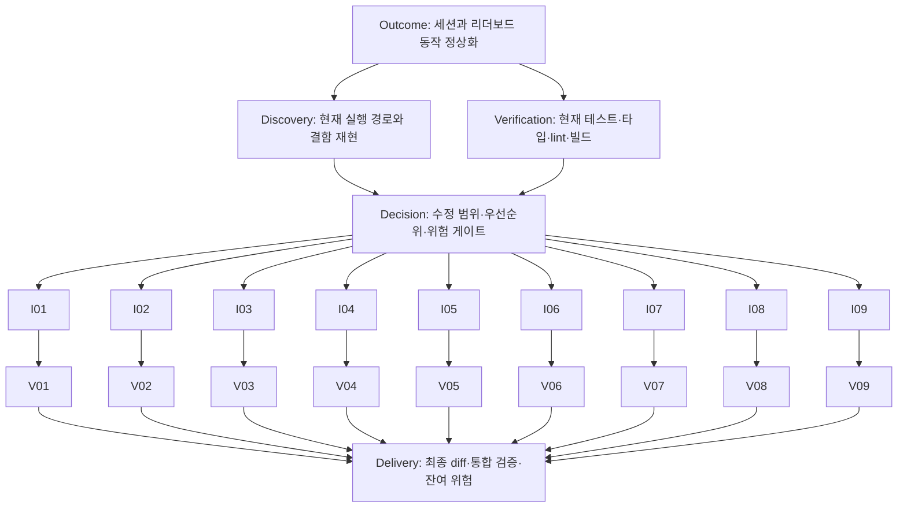

# Note Quiz 수정 계획

최초 기준일: 2026-09-08. 당시 `/practice` 실행 경로를 점검해 이 문서만 작성했다. 아래 재현 기록은 보존하되 체크 상태는 현재 코드에 맞췄다. 2026-10-31 구현·검증 상태와 남은 차단은 문서 하단의 S1–S7 기록을 기준으로 한다.

저장소에는 기존 계획 파일이 없어 새로 작성했다. 광고 스크립트 추가, `/ads.txt`의 301 route handler, 모바일 리더보드 중앙 모달은 구현되어 있어 할 일에서 제외했다. 모달 전환 이후에도 남아 있는 동작 결함은 별도 항목으로 기록한다.

## 목표와 범위

- 연습의 시간제한·일시정지·입력·결과 표시가 실제 세션 상태와 일치하도록 수정한다.
- 리더보드를 열고 닫을 때 화면과 스크롤이 정상적으로 복구되고, 최신 순위와 실패 상태를 구분해 보여준다.
- 국가 조회의 외부 의존성과 분석 이벤트를 기존 익명 플레이·데이터 최소화 계약에 맞춘다.
- 아래 항목은 코드 경로와 로컬 재현에 근거한다. 운영 장애 발생 빈도는 확인하지 않았다.
- 전체 디자인 개편, 레거시 화면 재작성, 점수 공식 변경, 신규 의존성, DB 배포는 이번 계획의 구현 범위에 포함하지 않는다.

## 2026-09-08 결함 목록 — 현재 완료 상태 반영

아래 재현·파일 위치는 당시 기록이다. 체크된 항목은 현재 코드에서 수정되었으며 이번 검증 근거와 남은 외부 확인은 문서 하단에 기록한다. 현재 로컬 구현·검증은 S1–S7 완료이며 I07/R01 및 실기기·운영 환경은 별도 외부 확인 항목이다.

P1은 연습 진행·채점 또는 페이지 사용을 직접 방해하므로 먼저 수정한다. P2는 그다음 정확성·데이터 표시·계약 일치를 개선한다. 우선순위는 이번 검토의 권고다.

### [x] I01 · P1 — 청음 시간제한 자동 종료

- **근거/소유 파일:** `src/components/practice/EarPracticeMode.tsx:68`, `src/store/earTrainingStore.ts`의 `updateTimer`·`endSession`. 현재 interval은 시간만 갱신하고 timed 종료 조건을 검사하지 않는다.
- **재현:** timed 30초 설정에서 31초가 되어도 `sessionState: playing`, `elapsedTime: 31000`, `result: null`. 실제 코드와 store를 사용한 메모리 재현으로 확인했다.
- **수정:** timed 모드에서 동일한 기준 시각으로 경과 시간과 제한을 판정하고 한 번만 종료한다. 종료 후 예약된 문제 전환과 입력도 무효화한다.
- **완료 기준:** 30/60/180초 경계에서 결과가 한 번만 생성되고 이후 답변이 누적되지 않는다. practice 모드는 자동 종료되지 않는다. 경계 단위 테스트와 `/practice?mode=ear`의 시작→자동 종료→다시 시작을 확인한다.

### [x] I02 · P1 — 독보 답변 후 일시정지 시 입력 잠김

- **근거/소유 파일:** `src/components/practice/NotePracticeMode.tsx:119`, `:154`, `:237`. 850ms 뒤 콜백이 paused 상태에서 실행되면 다음 문제 생성이 취소되지만 `currentQuestion`과 `isAnswerLocked`는 유지된다.
- **재현:** 답변→850ms 이내 일시정지→850ms 이상 대기→재개하면 `playing`인데 입력은 잠겨 있고 문제 전환 콜백도 없다. 메모리 재현으로 확인했다.
- **수정:** 대기 중인 문제 전환과 타이머를 관리하여 재개 시 한 번 처리한다. 종료·초기화·컴포넌트 해제 시 타이머를 취소하고 이전 세션 콜백이 새 세션에 적용되지 않게 한다.
- **완료 기준:** 위 순서에서 다음 문제를 풀 수 있고 답안은 한 번만 남는다. 연속 pause/resume, 대기 중 종료·다시 시작도 검증한다. 일시정지 구간은 세션 시간에서 제외된다.

### [x] I03 · P1 — 건반 연타로 같은 문제 중복 채점

- **근거/소유 파일:** `src/components/game/PianoKeyboard.tsx:74`, `src/components/game/SolfegeKeyboard.tsx:75`, `src/components/practice/NotePracticeMode.tsx:215`. 두 키보드는 현재 `/practice`에서도 사용한다. 오디오 완료를 기다린 콜백들이 이전 렌더의 `isAnswerLocked: false`를 함께 보관한다.
- **재현:** 같은 렌더의 오디오 완료 콜백을 연속 처리하면 한 문제에 답안 2개와 전환 타이머 2개가 생긴다. 메모리 재현으로 확인했다.
- **수정:** 답변 제출 시점을 오디오 종료와 분리하고, 최신 문제·세션에 대한 동기 잠금으로 답안을 한 번만 받는다. 렌더 state만으로 중복을 막지 않는다.
- **완료 기준:** 500ms 이내 2~3회 연타해도 답안·문제 전환은 각각 1회다. 재생 시간이 답변 시간에 가산되지 않고, 종료·새 세션 이후 도착한 입력은 무시한다. 공유 키보드를 쓰는 청음도 확인한다.

### [x] I04 · P1 — 리더보드의 숨겨진 모달이 데스크톱 스크롤을 잠금

- **근거/소유 파일:** `src/components/practice/LeaderboardTicker.tsx:72`, `:135`, `:149`, `src/app/practice/PracticeClient.tsx:28`. 모든 폭에서 open 상태를 켜고 body 스크롤을 잠그지만, 모달은 `lg:hidden`으로 숨긴다.
- **재현:** 1280×800에서 `?leaderboard=open` 진입, 티커 클릭, 모바일에서 모달을 연 채 데스크톱 폭으로 확대하는 경우 모두 `overflow: hidden`인데 모달·닫기 버튼은 보이지 않았다. 로컬 브라우저에서 확인했다. 모바일에서는 Escape로 닫히지 않고 첫 Tab이 모달 밖 링크로 이동했다.
- **수정 결정:** 클릭·쿼리로 여는 중앙 모달을 모든 화면 폭에서 사용할 수 있게 한다. 기존 hover 미리보기는 명시적으로 열린 모달과 동시에 표시하지 않는다. 표시 중인 모달만 스크롤을 잠그고 닫기·해제 시 원래 값을 복구한다. 초기 포커스·포커스 유지/복귀·Escape 닫기를 처리한다.
- **완료 기준:** 데스크톱 클릭/직접 링크, 모바일 클릭, 열린 채 폭 변경에서 항상 닫을 수 있다. X·배경 클릭·Escape 후 스크롤과 포커스가 복구된다. 400×669와 1280×800에서 빈 목록 및 10개 순위 내부 스크롤을 확인한다. 새 접근성 문구는 6개 언어에 반영한다.
- **잔여 검증:** 광고를 차단한 로컬 검증만 수행했다. 실제 Mediavine 하단 광고와 긴 목록의 겹침은 운영 환경에서 별도 확인해야 한다. 중앙 배치만으로 광고 비겹침을 보장하지 않는다.

### [x] I05 · P2 — flat 음표의 재생 주파수가 A4로 대체됨

- **근거/소유 파일:** `src/lib/music/utils.ts:111`, `src/lib/music/constants.ts:187`, 호출 경로 `src/components/practice/NotePracticeMode.tsx:140` → `src/lib/music/audio.ts`. 주파수 표에 없는 음이름은 모두 440Hz를 반환한다.
- **재현:** 실제 함수에서 `Db4=440`이지만 `C#4=277.18`, `Bb4=440`이지만 `A#4=466.16`이다. 악보에 보이는 음과 소리가 달라진다.
- **수정:** 기존 반음/MIDI 변환이 있으면 재사용하여 임시표와 옥타브 경계를 포함한 주파수를 계산한다. 유효한 음을 조용히 A4로 대체하지 않는다.
- **완료 기준:** `Db4=C#4`, `Bb4=A#4`, `E#4=F4`, `B#4=C5`, `Cb4=B3`을 허용 오차 내에서 검증한다. 출제 가능한 음 범위를 테스트하고 flat 조표의 소리를 브라우저에서 확인한다.

### [x] I06 · P2 — 이전 세션의 늦은 제출 응답이 새 결과를 덮어씀

- **근거/소유 파일:** `src/components/practice/NotePracticeMode.tsx:195`. 제출 promise의 성공/실패 처리가 현재 결과의 session ID를 확인하지 않고 표시 상태를 변경한다.
- **재현:** A 제출 대기→B를 0문항으로 종료하면 처음에는 `0/ineligible`이지만, A 응답 도착 후 `18/accepted`로 바뀐다. 실제 제출 effect의 메모리 재현으로 확인했다.
- **수정:** 요청 당시 세션과 현재 결과를 대조해 일치할 때만 점수·상태를 반영한다. 늦은 실패, 초기화, 모드 전환도 같은 기준으로 처리한다.
- **완료 기준:** A/B 응답 순서 역전, B 비적격, reset 후 성공/실패가 B의 표시를 바꾸지 않는다. 표시 방어를 추가해도 DB 제출·중복 방지 계약은 유지된다.

### [ ] I07 · P2 — 외부 국가 조회: timeout 완료 / 신뢰 헤더 정책 외부 확인

- **현재 상태:** 외부 fetch와 응답 파싱 전체에 2초 제한 및 실패 fallback을 구현·검증했다. 아래 헤더 우선 정책은 배포 프록시의 보증 여부가 미확인이므로 변경하지 않았다. 익명성·API·서버 검증 계약은 유지한다.

- **근거/소유 파일:** `src/lib/leaderboard/country.ts:105`, `:128`, `src/app/api/leaderboard/route.ts`, `src/app/api/leaderboard/scores/route.ts`. 국가 헤더보다 외부 IP 조회를 먼저 기다리며 요청 timeout이 없다.
- **재현:** 유효한 `KR` 국가 헤더가 있어도 외부 응답의 `US`를 먼저 반환한다. 외부 promise가 끝나지 않으면 국가 헤더가 있어도 조회가 대기한다. 외부 fetch stub으로 확인했으며 실제 외부 서비스 장애를 재현한 것은 아니다.
- **수정 결정:** 배포 프록시가 보증하는 국가 헤더를 우선하고 필요할 때만 외부 조회한다. 초기 timeout은 2초를 제안하며, 오류·timeout·유효하지 않은 국가에는 `XX`로 빠르게 fallback한다.
- **완료 기준:** 신뢰 헤더가 있으면 외부 요청 0회. 외부 hang/오류/잘못된 결과에서도 제한 시간 내 종료하고 GET/POST의 DB 경로가 진행된다. 헤더·fallback·timeout 단위 테스트와 API 테스트를 추가한다.
- **위험 게이트:** 실제 호스팅의 헤더 제거·덮어쓰기 정책을 확인한 뒤 신뢰할 헤더를 선정한다. 임의의 클라이언트 `x-country-code`를 신뢰하도록 바꾸지 않는다. 운영에서 헤더 위조가 가능하다고 단정한 것은 아니다.

### [x] I08 · P2 — 리더보드가 갱신되지 않고 실패를 빈 목록으로 표시

- **근거/소유 파일:** `src/components/practice/LeaderboardTicker.tsx:28`, `:47`, `:212`, `src/app/practice/PracticeClient.tsx`, `src/components/practice/NotePracticeMode.tsx`, `src/lib/i18n/translations.ts`. 조회 effect가 최초 마운트 한 번뿐이고, 실패·로딩·빈 목록이 모두 빈 entries로 처리된다. 목록의 빈 문구는 영어로 고정되어 있다.
- **재현:** 모바일에서 닫기→재열기 후에도 `/api/leaderboard` 요청은 1회다. HTTP 500 응답에서도 `No leaderboard data yet.`를 표시한다. 로컬 브라우저와 응답 fixture로 확인했다. 같은 `/practice`에서 점수 제출 후에도 새 조회를 유발하는 연결이 없다.
- **수정:** 명시적으로 열 때와 점수 등록 성공 후 재조회하고 오래된 응답이 최신 목록을 덮지 않도록 한다. 로딩·실패·빈 결과를 분리하고 기존 번역 `leaderboard.loading/error/empty`를 사용한다. 오류 재시도 경로를 제공한다.
- **완료 기준:** 제출 후 재진입 시 갱신된 순위가 표시된다. 500→재시도 성공, 실제 빈 목록, 지연 응답을 각각 검증한다. 기존 번역 6개 언어를 확인하고 새 문구가 필요하면 타입·6개 항목을 함께 추가한다.

### [x] I09 · P2 — 청음 정답·입력 음이 분석 이벤트로 전송됨

- **근거/소유 파일:** `src/store/earTrainingStore.ts:191` → `src/lib/analytics.ts:126`. 답변마다 `expected_note`, `user_note`가 GA 이벤트에 포함되어 프로젝트의 답안 전송 금지 지침과 불일치한다.
- **재현:** production 조건과 gtag stub에서 `expected_note: C4`, `user_note: D4` payload를 확인했다. 실제 GA 전송은 하지 않았다.
- **수정:** 음이름 필드를 호출부와 payload 타입에서 제거한다. 기존 완료 이벤트의 세션 집계로 충분한지 검토하여 답변별 이벤트의 필요성도 줄인다.
- **완료 기준:** 분석 이벤트에 정답 음·입력 음·세션 식별자가 없고, 필요한 시작/완료 집계는 유지된다. production analytics stub 테스트로 전송 필드를 확인한다.

## 구현 전 추가 확인 — 확정 결함과 구분

### [ ] R01 — DB 보존 기간 정리 작업의 운영 스케줄 확인

- `supabase/leaderboard.sql:263`에 7일 영수증·90일 집계 삭제 함수는 구현되어 있다. 저장소에는 이 함수의 호출/스케줄 경로가 보이지 않지만, 별도로 배포된 작업이 없다고 단정할 수 없다.
- `src/app/privacy-policy/page.tsx:66`과 번역에는 해당 보존 기간이 안내되어 있다.
- **담당/입력/산출물:** 운영 담당자가 실제 Supabase job 정의·최근 성공 기록·대상 테이블을 확인하여 보존 기간 집행 근거를 남긴다. 읽기 전용 확인은 코드 수정 노드와 독립적이다.
- **결정 게이트:** 정상 작업이 있으면 추가 구현 없이 항목을 제거한다. 없으면 멱등적 스케줄 설정과 운영 검증을 별도 계획으로 구체화한다. SQL 실행·배포는 사용자 요청을 받은 후 수행한다.

## 후속 구현 DAG와 책임

이번 점검은 D/V0/C까지 완료했다. 아래 I/V/L은 후속 구현 시 사용할 계획이며 완료된 것으로 취급하지 않는다. 모든 I 노드는 한 명의 구현 담당자가 순차적으로 작성한다. 특히 I02/I03/I06/I08의 파일 소유가 겹치므로 동시 production 쓰기는 하지 않는다. 아래 병렬 분기는 코드 의존성이 없다는 뜻이며 쓰기 병렬화 지시가 아니다.

| 노드 | 담당 | 입력 → 산출물/완료 근거 | 의존성·위험 게이트 |
| --- | --- | --- | --- |
| O | 계획 담당 | 사용자 문제와 프로젝트 계약 → 위 목표·완료 기준 | 코드 구현·배포와 계획 작성을 구분 |
| D | UI 검토 담당 + practice/leaderboard reviewer | 현재 코드 → 위 9개 항목의 위치·재현 근거 | O; 읽기 전용 검토 |
| V0 | verifier | 현재 저장소 → 아래 baseline 결과 | O; 환경 오류를 제품 결함과 구분 |
| C | 계획 담당 | D/V0 → P1 우선, 기존 패턴 활용, 완료 작업 제외 | D/V0; I07/R01의 인프라 확인 조건 유지 |
| I01–I09 | 단일 구현 담당 | 해당 항목의 소유 파일·재현 조건 → 한 가지 결함을 다루는 변경 | C; 정확한 소유 파일·수용 기준은 각 항목 참조 |
| V01–V09 | verifier/reviewer | 대응 I의 diff → 해당 완료 기준의 테스트·UI 증거 | 대응 I; 변경 직후 가장 좁은 검증부터 실행 |
| L | 구현 담당 + reviewer | 모든 V 결과 → 최종 diff, 통합 검증, 미검증 범위 전달 | 모든 필수 V 통과 또는 사용자가 수용한 잔여 위험; 커밋·배포 별도 요청 |

검증 실패는 제품 결함·테스트 결함·환경 문제·기존 실패로 분류한다. 새 증거가 있을 때만 해당 I/V 사이에 corrective 노드를 추가한다. 같은 차단 원인에 대한 corrective 노드가 3회 실패하면 그 분기를 중단하고 근거와 필요한 결정을 보고한다. 다른 독립 검증은 계속할 수 있지만 필수 분기가 미해결이면 전체 완료로 표시하지 않는다.

## 이번 점검에서 실제 수행한 검증

| 검사 | 결과 |
| --- | --- |
| `npx vitest run src/lib/sessionTimer.test.ts` | 2/2 통과 |
| `npx vitest run src/store/gameStore.test.ts src/lib/sessionTimer.test.ts` | 5/5 통과 |
| `npx vitest run src/lib/leaderboard/validation.test.ts src/lib/leaderboard/supabase.test.ts src/app/api/leaderboard/scores/route.test.ts` | 23/23 통과 |
| `npm test` | 5개 파일, 28/28 통과 |
| `npx tsc --noEmit` | 통과 |
| `npm run lint` | 통과, 기존 Hook 의존성 경고 2개 |
| `npm run build` | 통과, 정적 페이지 14/14 생성 |
| 로컬 production 서버 + Playwright/설치된 Chrome headless | 400×669 / 1280×800에서 I04·I08 재현, 모바일 중앙 배치·X 닫기 확인 |
| `/ads.txt` 로컬 HTTP 요청, redirect 미추적 | 301 및 제공된 Mediavine URL의 Location 확인 |

기존 경고는 `src/components/ui/modal.tsx:74`의 `isPage`, `src/hooks/useComponentSize.tsx:23`의 `handleResize` 의존성 누락이다. 현재 활성 경로에서 사용되는 근거를 찾지 못해 주요 수정 항목으로 올리지 않았다.

검증 한계:

- 기존 28개 테스트 통과는 위 버그가 없다는 뜻이 아니다. 컴포넌트 콜백·청음 종료·음 주파수 경로에 테스트 공백이 있다.
- I01/I02/I03/I06은 실제 TypeScript 소스와 store/effect를 사용하되 React hooks·시계·오디오를 대체한 메모리 재현이다. 실제 터치·오디오 브라우저 재현으로 대체하지 않는다.
- 브라우저 검증에서는 광고·분석 등 외부 요청을 차단하고 리더보드 응답을 fixture로 제공했다. 실제 Supabase 데이터·동시 제출·SQL 배포·cleanup 스케줄·Mediavine 광고·모바일 실기기는 확인하지 않았다.
- Playwright 기본 번들 브라우저는 설치되어 있지 않아 최초 실행이 실패했다. 환경 문제로 분류하고 이미 설치된 Chrome으로 동일 검증을 성공시켰다.
- 후속 수정 시 항목별 가장 좁은 테스트를 먼저 실행한다. 공유 상태·채점·타이머·API·리더보드 변경은 전체 `npm test`, TypeScript 변경은 `npx tsc --noEmit`, lint 및 production 경로 변경은 `npm run build`까지 확인한다. UI 변경은 두 화면 폭에서 실제 조작을 검증한다.

## 2026-10-31 전체 학습 흐름 확장 — 현재 실행 계획

이 절은 2026-09-08 기록을 보존하면서 현재 코드와 새 요청을 기준으로 갱신한다. 이전의 “문서 작성뿐” 설명과 검증 숫자는 당시 기록이며 이번 구현 상태를 나타내지 않는다.

### 현재 상태 재확인

- 기준 커밋 `f5dcb93`, 사용자 변경은 기존 untracked `plan.md`뿐이었다.
- `/practice`가 실제 실행 경로이며 `localhost:3001`의 PID 39858 작업 디렉터리가 이 저장소임을 확인했다. 기존 서버를 재사용한다.
- I04(대화상자/화면 폭), I08(로딩/실패/빈 결과/재열기 조회)은 이미 구현되어 재구현하지 않는다. 이번 통합 검증에서 다시 확인한다.
- I01/I02/I03/I05/I06/I09는 현재 코드에도 남아 있다. 세션 종료의 멱등성, 질문 시간의 pause 제외, 오디오 사용자 동작/오래된 초기화 방어도 함께 보완한다.
- I07 국가 조회의 timeout은 검토하되 신뢰 헤더 정책은 운영 확인 없이 확대하지 않는다. R01 DB 보존 스케줄은 운영 확인 사항이며 SQL 실행/DB 변경은 범위 밖이다.
- 사용량 감소 원인과 실제 운영 효과는 분석 접근 근거가 없어 미확인이다.

### 구현 단계와 완료 근거

- [x] S1 — 기존 세션·음 높이·오디오 정확성: 타이머 경계/중복 입력/pause/이전 콜백/이명동음 회귀 테스트.
- [x] S2 — 독보·단음 청음 기본 10문제, 자유/시간제한 유지, 공통 결과·원문맥 오답 복습. 리뷰/일일 재연습의 기존 국가 점수 중복 제출 차단.
- [x] S3 — 음정 청음/악보, 높낮이 입문·기본·확장·사용자 설정, 상행/하행/동시 재생, 시작 전 예시/답변 후 설명.
- [x] S4 — 코드 종류/전위/장조 I·IV·V·vi 진행의 청음과 악보, 구성음/동시·순차 재생, 순수 생성/표기/채점 테스트.
- [x] S5 — 프리셋, UTC 날짜·모드·난이도로 생성하는 일일 10문제, 제한된 브라우저 기록·약점/초기화, 허용 목록 URL 설정 공유.
- [x] S6 — 광고 공간/너비/하단 여유/모달 배치, 모바일 연습 선택 UI, 6개 언어·접근성·오디오 실패 복구, 개인정보를 제한한 세션 분석·지표 문서. 로컬 구현 완료이며 광고·실기기 검증의 범위는 아래 별도 기록한다.
- [x] S7 — 전체 단위 테스트/TypeScript/lint/production build, computer use로 기존/신규 전체 흐름, 최종 diff·독립 리뷰. 수행 범위와 미확인 실환경은 아래 기록한다.

새 운영 의존성/계정/DB/광고 사업자 설정은 추가하지 않는다. 이 작업에는 커밋·푸시·배포·운영 SQL·외부 메시지를 실행하지 않는다.

### 외부 확인 필요 / 완료와 구분

- [x] 390×844/1440×900에서 실제 Grow house 하단·데스크톱 사이드 소재 노출과 겹침 확인. 아래 최종 별도 관찰 기록에 근거하며 모바일 실기기·유료 소재 전체는 확인하지 않았다. 슬롯/모의 광고는 별도 근거로 분류한다.
- [ ] 모바일 실기기와 실제 소리 청취 가능 여부 확인. 수행하지 않은 경우 미확인으로 남긴다.
- [ ] 운영 분석 수치와 유입 감소 원인, DB 보존 스케줄은 별도 운영 접근이 필요하다.

### 2026-10-31 추가 UI 요청 — 설정 통일·청음 안내 축소

- [x] 독보·단음 청음·음정·코드 설정에 공통 라벨, 선택 버튼, select, 체크박스 행 스타일을 적용했다. 선택 버튼은 연보라 배경·보라 테두리와 `aria-pressed`, 키보드 포커스를 공유한다.
- [x] 청음 안내의 140/240px 최소 높이와 내부 카드를 제거하고, 짧은 안내·다시 듣기·작은 피드백 영역으로 배치했다. 피드백 라벨과 음 이름의 공간을 유지해 건반 위치 변경을 방지한다. 독보 악보 크기와 채점·오디오·세션 로직은 이 UI 수정에서 변경하지 않았다.
- [x] Computer use: 1440×900 및 390×844에서 설정 전환·모달·키보드 포커스·재생·답변을 확인했다. 영어 청음의 답변 전후 건반 문서 좌표가 데스크톱/모바일 모두 동일했다. 모바일 독일어 줄바꿈, 음정 설정, 코드 사용자 설정 체크박스도 확인했다.
- [x] 최종 `npm test`: 16개 파일, 180개 테스트 통과. `npx tsc --noEmit` 통과. 수정한 설정·청음 파일의 좁은 lint 통과. 전체 lint의 기존 경고와 production build는 전체 확장 작업의 검증과 구분한다.
- 이 절은 위 S1–S7 전체 완료를 의미하지 않는다. 실제 소리 청취·모바일 실기기·모든 광고 배치의 정상 동작을 이 UI 확인만으로 보증하지 않는다. UI 변경에는 production build를 별도로 실행하지 않았다.

### 단계 검증 기록 (2026-10-31, 진행 중)

- S1 로컬 구현: 기존 스토어 회귀 22개, 음 높이 10개, 오디오 예약/취소 8개 통과. 분석의 답안 단위 이벤트를 제거했고 세션 이벤트 데이터 최소화 8개 테스트를 통과했다. 국가 외부 조회에는 2초 제한만 추가했으며 신뢰 헤더 순서는 바꾸지 않았다. I07의 헤더 신뢰 정책/R01 운영 스케줄은 외부 확인으로 유지한다.
- S2~S5 로컬 구현: 기존/신규 10문제·결과·복습, 음정·코드·전위·진행 순수 함수 43개, 설정 27개/기록 25개/seed 4개 검증을 포함해 전체 186개 테스트 통과(이 시점). 전체 TypeScript 통과, lint는 기존 경고2개만 남았다.
- 실제 computer use: 브라우저 호스트 API는 미연결이었으나 native Chrome 접근으로 `localhost:3001`을 검증했다. 코드 악보 공유 링크에서 자동 시작 없음 → 사용자 시작 →10문제(4/10) → 원래 오답6개를 다른 근음으로 복습(6/6) →별도 복습 결과/국가 점수 제외 안내를 확인했다. 결과 제목으로 포커스가 이동했다.
- 실제 광고: Chrome에 Grow house 광고 소재가 표시되었다. 오른쪽 설정과 광고의 겹침을 재현했으며 광고 wrapper 기하에 따른 공간 예약을 수정/재확인 중이다. 이 관찰을 모든 광고 소재/실기기 해결 근거로 확대하지 않는다.
- 남은 필수 검증: 광고 보정 후 실제 조작, 모든 모드의 전체 흐름·공유·일일·기록·작은 화면·긴 번역, production build/최종 diff. 이 절은 아직 전체 완료 기록이 아니다.

### 최종 자동 검증과 실제 조작 완료 (2026-10-31)

- `npm test` 17파일 **189/189**, `npx tsc --noEmit`, `npm run lint`, production build 통과. Lint는 기존 Hook 경고2개만 남았다. 개발 서버를 재시작하지 않고 `/tmp/note-quiz-learning-build-20261031`에서 빌드했으며 최종 소스124파일 해시가 일치했다.
- 별도 Chrome 프로필의 390×844/1440×900 자동 검증: 기능/반응형/모의 광고 **15항목 통과**, 마지막 실행의 실제 광고 관찰 **2항목 미관찰**, 앱 오류/검증 경고0개. 네 모드10문제/복습/재시작, 음정·코드·전위·진행의 청음/악보, timed·지연응답, 일일/공유/기록, 저장소·오디오 실패, 6개 언어를 포함한다.
- 자정 검증에서 정적 HTML의 날짜와 브라우저 날짜 불일치에 의한 hydration 오류를 발견·수정했다. 초기 날짜를 동일하게 두고 클라이언트에서 확정하며 준비 전 일일 문제 생성을 막았다. 자정 진행 상태·이전 날짜 결과·복습·새 날짜 명시적 선택과 엄격한 앱 오류 검사가 통과했다.
- 광고: 실제 Grow 소재가 표시된 desktop에서 설정 sticky와 Journey 광고의 겹침을 재현했다. 설정 자체 sticky 제거, 실제 wrapper 공간 예약, 하단 광고를 제외한 스크롤 영역/모달 배치로 수정했다. 앞선 실제 소재 스크린샷은 보존했고 마지막 실행의 소재 미노출과 구분한다. 광고 iframe/스크립트/사업자 설정은 변경하지 않았다.
- 독립 리뷰(세션·음악·기록/공유·분석·광고/푸터/스크롤·날짜 수정)와 최종 diff 검사에서 중요한 잔여 결함을 찾지 못했다.
- **S7 완료:** 사용자의 연결 복구 안내 후 native Chrome으로 남은 실제 조작을 수행했다. 브라우저 호스트 API 미연결과 창 전환은 native 직접 연결/검증 탭 보호 검사로 대응했다. 390×844/1440×900, 기존·신규 모드의 시작/답변/결과/복습/재시작, 공유/새로고침/일일 완료, 모달 닫기·포커스·크기 변경, 독일어 긴 문구를 확인했다. 자동 검증과 실제 조작 증거는 구분해 기록했다.
- 실제 소리 청취·모바일 실기기·유료 소재 전체·운영 효과는 미확인이다. I07 신뢰 헤더/R01 운영 보존 작업은 외부 확인 범위로 유지한다. 커밋·푸시·배포·운영 SQL은 실행하지 않았다.
- 상세 범위 점검/실행 명령/증거/검증 한계: `docs/learning-verification.md`. 지표 정의: `docs/learning-metrics.md`.
- 후속 실제 광고 관찰: 최종 소스에서 가상 시계 없이 390×844/1440×900 모두 Grow house 소재를 확인했다. 각5개 스크롤 위치에서 주요 조작부 중심/네 모서리 가림0개, 하단 광고와 모달 비겹침. 데스크톱 sidebar300×250와 bottom728×90 동시 표시. `/tmp/note-quiz-final-live-house-ad.json`과 `*-final-live-house-ad-{scroll,dialog}.png`에 별도 보존했다. 모바일 폭의 데스크톱 Chrome 관찰을 모바일 실기기/모바일 전용 소재로 확대하지 않는다.
- 실제 조작에서 진행 문제에 종류/전위 안내가 표시되는 문구 오류를 발견해 기존6개 언어의 조성 안내로 교체하고 중복 안내를 제거했다. 이후 전체189테스트/TypeScript/lint/production build, 음정·코드11개 하위 변형 재검증이 통과했다. 최종 소스와 빌드 복사본의 차이는 없다.
- 범위 점검: 기존 세션 정확성·10문제/결과/복습, 음정·코드/전위/진행, 프리셋·일일·로컬 기록/약점·공유, 반응형/번역/접근성/광고 공간, 분석 최소화와 지표 문서까지 구현·검증했다. 로컬 작업의 남은 차단은 없다. 운영/실기기 미확인은 위 외부 항목으로 남긴다.
